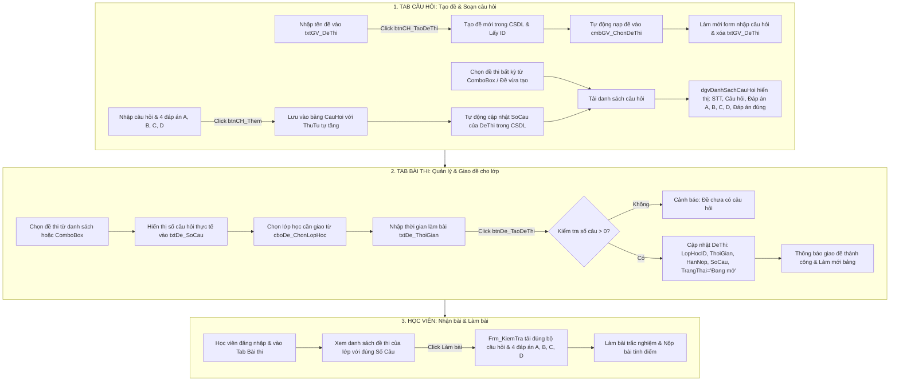

# Báo Cáo Kiểm Tra & Hướng Dẫn Hoàn Thiện Tính Năng Tạo Câu Hỏi Và Giao Đề Thi

> **Dự án**: BLT_Quan_Ly_Hoc_Tap (Ứng dụng Quản lý học tập & thi trắc nghiệm C# WinForms - PostgreSQL)  
> **Tài liệu**: Phân tích kỹ thuật, phát hiện lỗi và hướng dẫn tối ưu luồng tạo câu hỏi kèm đáp án & giao đề thi.

---

## 1. Tổng quan & Kết quả kiểm tra hiện trạng (Audit)

Hệ thống quản lý đề thi và câu hỏi của giáo viên hiện được triển khai tại:
- Form giao diện: `Forms/frm_GiaoVien.cs` và `Forms/frm_GiaoVien.Designer.cs`
- Tầng truy xuất dữ liệu: `DAL/DeThiDAL.cs`
- Mô hình dữ liệu: `Models/DeThi.cs`, `Models/CauHoi.cs`
- Học viên thi: `Forms/Frm_HocVien.cs`, `Forms/Frm_KiemTra.cs`

Qua kiểm tra toàn diện mã nguồn, đã phát hiện **5 bất cập và lỗi cốt lõi** sau:

### Vấn đề 1: `dgvDanhSachCauHoi` KHÔNG hiển thị các đáp án A, B, C, D
- **Hiện trạng**: Trên lưới `dgvDanhSachCauHoi` chỉ có 4 cột:
  1. `dataGridViewTextBoxColumn19`: Mã Đề (`DeThiID`)
  2. `dataGridViewTextBoxColumn20`: Câu Hỏi (`NoiDung`)
  3. `dataGridViewTextBoxColumn21`: Đáp Án Đúng (`DapAnDung`)
  4. `dataGridViewTextBoxColumn22`: Thứ Tự (`ThuTu`)
- **Hệ quả**: Giáo viên khi xem danh sách câu hỏi **hoàn toàn không thấy các phương án lựa chọn A, B, C, D** của câu hỏi. Cột "Mã Đề" chỉ hiện số ID nội bộ vô nghĩa với người dùng.
- **Yêu cầu**: Cần hiển thị rõ ràng: `STT`, `Nội Dung Câu Hỏi`, `Đáp Án A`, `Đáp Án B`, `Đáp Án C`, `Đáp Án D`, `Đáp Án Đúng`.

### Vấn đề 2: Số câu hỏi (`SoCau`) trong bảng `DeThi` luôn bằng 0
- **Hiện trạng**:
  - Khi bấm `btnCH_TaoDeThi`, hàm `TaoDeThiMoiLayID` khởi tạo `SoCau = 0`.
  - Khi thêm câu hỏi (`btnCH_Them`) hoặc xóa câu hỏi (`btnCH_Xoa`), chỉ tác động tới bảng `CauHoi`, **không cập nhật trường `SoCau`** trong bảng `DeThi`.
  - Khi giao đề thi (`btnDe_TaoDeThi`), hàm `GiaoDeThiChoLop` cũng không cập nhật trường `SoCau`.
- **Hệ quả**:
  - Tại bảng Quản lý đề thi của Giáo viên (`dgvDanhSachDeThi`), cột "Số câu" luôn hiển thị `0`.
  - Tại màn hình Học viên (`Frm_HocVien`), danh sách bài thi sắp tới hiển thị "Số Câu: 0", gây khó hiểu và sai lệch thông tin bài thi.

### Vấn đề 3: Vị trí ComboBox chọn đề thi (`cmbGV_ChonDeThi`) bị lệch tab
- **Hiện trạng**:
  - Trong code logic `frm_GiaoVien.cs`, việc xem câu hỏi, thêm câu hỏi (`btnCH_Them`) đều dựa vào `cmbGV_ChonDeThi.SelectedValue`.
  - Tuy nhiên trong `frm_GiaoVien.Designer.cs`, `cmbGV_ChonDeThi` lại được gắn vào `tableLayoutPanel6` của **Tab Quản Lý Đề Thi** (Tab Bài Thi), chứ **KHÔNG nằm ở Tab Ngân Hàng Câu Hỏi**!
  - Ở Tab Câu Hỏi chỉ có ô `txtGV_DeThi` và nút `btnCH_TaoDeThi`.
- **Hệ quả**:
  - Khi giáo viên đang ở Tab Câu Hỏi, nếu muốn chọn một đề thi đã tạo từ trước để xem câu hỏi hoặc thêm câu hỏi mới, **không có ComboBox nào trên giao diện để chọn**!
  - Nếu giáo viên nhập lại tên đề cũ vào `txtGV_DeThi` rồi nhấn `btnCH_TaoDeThi`, hệ thống sẽ tạo thêm một đề thi mới trùng tên với 0 câu hỏi!

### Vấn đề 4: Lệch pha giữa ComboBox và Grid khi giao đề thi (`btnDe_TaoDeThi`)
- **Hiện trạng**:
  - Nút `btnDe_TaoDeThi` ("Lưu và giao bài") kiểm tra biến `_selectedDeThiID`.
  - Biến `_selectedDeThiID` chỉ được cập nhật khi giáo viên click chuột vào một dòng trên bảng `dgvDanhSachDeThi` (`dgvDanhSachDeThi_CellClick`).
  - Nếu giáo viên chọn đề thi từ `cmbGV_ChonDeThi`, biến `_selectedDeThiID` không được cập nhật. Nhấn nút sẽ báo lỗi: *"Vui lòng chọn đề thi từ danh sách!"*.
  - Hạn nộp hiện đang bị gán cứng `DateTime.Now.AddDays(7)` thay vì cho giáo viên chỉ định.

### Vấn đề 5: Thứ tự câu hỏi (`ThuTu`) bị gán cứng bằng 1
- **Hiện trạng**: Trong `btnCH_Them_Click`:
  ```csharp
  ThuTu = 1
  ```
  Mọi câu hỏi được thêm vào CSDL đều có `ThuTu = 1`, không tự động tăng `1, 2, 3...`.

---

## 2. Sơ đồ luồng chuẩn hóa (Standard Workflow)



---

## 3. Hướng dẫn chi tiết từng bước & Mã nguồn khắc phục

### Bước 1: Cải tiến DAL (`DAL/DeThiDAL.cs`)

Cần cập nhật `DeThiDAL.cs` để:
1. Tự động tính số câu hỏi thực tế qua subquery `COUNT(ch.CauHoiID)` khi lấy danh sách đề thi.
2. Thêm hàm `CapNhatSoCau(int deThiID)` để tự động đồng bộ trường `SoCau`.
3. Trong `GiaoDeThiChoLop`, cập nhật luôn `SoCau = (SELECT COUNT(*) FROM CauHoi WHERE DeThiID = @id)`.

#### Mã nguồn cần thay thế / bổ sung trong `DAL/DeThiDAL.cs`:

```csharp
// 1. Tối ưu hàm LayDeThiTheoGiaoVien: Số câu tự động lấy từ COUNT(CauHoi)
public DataTable LayDeThiTheoGiaoVien(int gvID)
{
    string sql = @"SELECT d.DeThiID, d.TenDeThi, d.MoTa, d.ThoiGian, d.MonHoc,
                          COALESCE((SELECT COUNT(*) FROM CauHoi c WHERE c.DeThiID = d.DeThiID), d.SoCau, 0) AS SoCau,
                          d.GiaoVienID, d.LopHocID, d.NgayTao, d.HanNop, d.TrangThai,
                          l.TenLop
                   FROM DeThi d
                   LEFT JOIN LopHoc l ON l.LopHocID = d.LopHocID
                   WHERE d.GiaoVienID = @gvID
                   ORDER BY d.DeThiID DESC";
    return DatabaseHelper.ExecuteQuery(sql, new NpgsqlParameter[] { new NpgsqlParameter("@gvID", gvID) });
}

// 2. Tối ưu hàm LayDeThiChoHocSinh: Đảm bảo học viên thấy đúng số câu
// (Trong câu truy vấn của LayDeThiChoHocSinh, thay d.SoCau bằng):
// COALESCE((SELECT COUNT(*) FROM CauHoi c WHERE c.DeThiID = d.DeThiID), d.SoCau, 0) AS SoCau

// 3. Thêm hàm tự động cập nhật số câu vào bảng DeThi
public bool CapNhatSoCau(int deThiID)
{
    string sql = @"UPDATE DeThi 
                   SET SoCau = (SELECT COUNT(*) FROM CauHoi WHERE DeThiID = @id)
                   WHERE DeThiID = @id";
    return DatabaseHelper.ExecuteNonQuery(sql, new NpgsqlParameter("@id", deThiID)) > 0;
}

// 4. Cập nhật hàm GiaoDeThiChoLop: Đồng bộ luôn SoCau khi giao đề
public bool GiaoDeThiChoLop(int deThiID, int lopHocID, int thoiGian, DateTime? hanNop)
{
    string sql = @"UPDATE DeThi
                   SET LopHocID = @lopID,
                       ThoiGian  = @tg,
                       HanNop    = @han,
                       SoCau     = (SELECT COUNT(*) FROM CauHoi WHERE DeThiID = @id),
                       TrangThai = 'Đang mở'
                   WHERE DeThiID = @id";
    NpgsqlParameter[] pars = {
        new NpgsqlParameter("@lopID", lopHocID),
        new NpgsqlParameter("@tg",    thoiGian),
        new NpgsqlParameter("@han",   (object)hanNop ?? DBNull.Value),
        new NpgsqlParameter("@id",    deThiID)
    };
    return DatabaseHelper.ExecuteNonQuery(sql, pars) > 0;
}
```

---

### Bước 2: Cấu hình `dgvDanhSachCauHoi` hiển thị đầy đủ ĐÁP ÁN (`Forms/frm_GiaoVien.cs`)

Để `dgvDanhSachCauHoi` hiển thị trực quan các câu hỏi kèm các đáp án A, B, C, D, ta viết một hàm cấu hình các cột trong `frm_GiaoVien.cs` (gọi tại `SetupEventHandlers()` hoặc sau khi Form nạp):

```csharp
private void CấuHinhLuoiCauHoi()
{
    dgvDanhSachCauHoi.AutoGenerateColumns = false;
    dgvDanhSachCauHoi.Columns.Clear();

    // 1. Cột Thứ tự (STT)
    dgvDanhSachCauHoi.Columns.Add(new DataGridViewTextBoxColumn
    {
        Name = "colThuTu",
        HeaderText = "STT",
        DataPropertyName = "ThuTu",
        Width = 60,
        DefaultCellStyle = new DataGridViewCellStyle { Alignment = DataGridViewContentAlignment.MiddleCenter }
    });

    // 2. Cột Nội dung câu hỏi
    dgvDanhSachCauHoi.Columns.Add(new DataGridViewTextBoxColumn
    {
        Name = "colNoiDung",
        HeaderText = "Nội Dung Câu Hỏi",
        DataPropertyName = "NoiDung",
        AutoSizeMode = DataGridViewAutoSizeColumnMode.Fill,
        FillWeight = 40
    });

    // 3. Cột Đáp án A
    dgvDanhSachCauHoi.Columns.Add(new DataGridViewTextBoxColumn
    {
        Name = "colDapAnA",
        HeaderText = "Đáp Án A",
        DataPropertyName = "DapAnA",
        AutoSizeMode = DataGridViewAutoSizeColumnMode.Fill,
        FillWeight = 15
    });

    // 4. Cột Đáp án B
    dgvDanhSachCauHoi.Columns.Add(new DataGridViewTextBoxColumn
    {
        Name = "colDapAnB",
        HeaderText = "Đáp Án B",
        DataPropertyName = "DapAnB",
        AutoSizeMode = DataGridViewAutoSizeColumnMode.Fill,
        FillWeight = 15
    });

    // 5. Cột Đáp án C
    dgvDanhSachCauHoi.Columns.Add(new DataGridViewTextBoxColumn
    {
        Name = "colDapAnC",
        HeaderText = "Đáp Án C",
        DataPropertyName = "DapAnC",
        AutoSizeMode = DataGridViewAutoSizeColumnMode.Fill,
        FillWeight = 15
    });

    // 6. Cột Đáp án D
    dgvDanhSachCauHoi.Columns.Add(new DataGridViewTextBoxColumn
    {
        Name = "colDapAnD",
        HeaderText = "Đáp Án D",
        DataPropertyName = "DapAnD",
        AutoSizeMode = DataGridViewAutoSizeColumnMode.Fill,
        FillWeight = 15
    });

    // 7. Cột Đáp án Đúng
    dgvDanhSachCauHoi.Columns.Add(new DataGridViewTextBoxColumn
    {
        Name = "colDapAnDung",
        HeaderText = "Đ.Án Đúng",
        DataPropertyName = "DapAnDung",
        Width = 90,
        DefaultCellStyle = new DataGridViewCellStyle { 
            Alignment = DataGridViewContentAlignment.MiddleCenter,
            Font = new Font("Segoe UI", 10F, FontStyle.Bold),
            ForeColor = Color.FromArgb(35, 168, 109)
        }
    });
}
```

Và hàm nạp dữ liệu khi đổi đề thi:

```csharp
private void cmbGV_ChonDeThi_SelectedIndexChanged(object sender, EventArgs e)
{
    if (cmbGV_ChonDeThi.SelectedValue != null && int.TryParse(cmbGV_ChonDeThi.SelectedValue.ToString(), out int deID))
    {
        var listCH = _deThiDAL.LayDanhSachCauHoi(deID);
        dgvDanhSachCauHoi.DataSource = listCH;
    }
    else
    {
        dgvDanhSachCauHoi.DataSource = null;
    }
}
```

---

### Bước 3: Nâng cấp `btnCH_TaoDeThi_Click` (Tạo đề thi mới từ `txtGV_DeThi`)

Khi nhấn nút `btnCH_TaoDeThi`:
1. Kiểm tra tên đề thi không được trống.
2. Kiểm tra tên đề thi đã tồn tại trong danh sách của giáo viên chưa (tránh tạo trùng lặp).
3. Tạo đề thi mới vào CSDL, lấy `newID`.
4. Nạp lại danh sách đề thi `LoadDeThiCombobox()`.
5. Đặt lựa chọn `cmbGV_ChonDeThi.SelectedValue = newID` -> Lưới `dgvDanhSachCauHoi` tự động nạp (lúc này là 0 câu).
6. Xóa trắng form nhập câu hỏi để giáo viên bắt đầu thêm câu hỏi cho đề vừa tạo.

```csharp
private void btnCH_TaoDeThi_Click(object sender, EventArgs e)
{
    string tenDe = txtGV_DeThi?.Text?.Trim();
    if (string.IsNullOrWhiteSpace(tenDe))
    {
        MessageBox.Show("Vui lòng nhập tên đề thi!", "Cảnh báo", MessageBoxButtons.OK, MessageBoxIcon.Warning);
        txtGV_DeThi?.Focus();
        return;
    }

    DeThi de = new DeThi
    {
        TenDeThi   = tenDe,
        MonHoc     = cboDe_MonHoc.SelectedItem?.ToString() ?? "Chung",
        GiaoVienID = Session.NguoiDungID,
        SoCau      = 0,
        ThoiGian   = 45,
        TrangThai  = "Chưa giao"
    };

    int newID = _deThiDAL.TaoDeThiMoiLayID(de);
    if (newID > 0)
    {
        MessageBox.Show(
            $"Tạo đề thi \"{tenDe}\" thành công!\nBây giờ bạn có thể nhập các câu hỏi và đáp án cho đề thi này.",
            "Thành công", MessageBoxButtons.OK, MessageBoxIcon.Information);

        // Làm mới ComboBox và chọn ngay đề thi vừa tạo
        LoadDeThiCombobox();
        try 
        { 
            cmbGV_ChonDeThi.SelectedValue = newID;
            _selectedDeThiID = newID;
        } 
        catch { }

        // Làm mới form để sẵn sàng soạn câu hỏi
        LamMoiFormCauHoi();
        if (txtGV_DeThi != null) txtGV_DeThi.Clear();
    }
    else
    {
        MessageBox.Show("Tạo đề thi thất bại! Vui lòng thử lại.", "Lỗi", MessageBoxButtons.OK, MessageBoxIcon.Error);
    }
}
```

---

### Bước 4: Nâng cấp `btnCH_Them_Click` (Thêm câu hỏi kèm đáp án & tự động tăng STT)

```csharp
private void btnCH_Them_Click(object sender, EventArgs e)
{
    if (cmbGV_ChonDeThi.SelectedValue == null)
    {
        MessageBox.Show("Vui lòng chọn hoặc tạo đề thi trước khi thêm câu hỏi!", "Thông báo", MessageBoxButtons.OK, MessageBoxIcon.Warning);
        return;
    }

    // Kiểm tra dữ liệu đầu vào
    if (string.IsNullOrWhiteSpace(txtCH_NoiDung.Text))
    {
        MessageBox.Show("Vui lòng nhập nội dung câu hỏi!", "Cảnh báo", MessageBoxButtons.OK, MessageBoxIcon.Warning);
        txtCH_NoiDung.Focus();
        return;
    }

    if (string.IsNullOrWhiteSpace(txtCH_DapAnA.Text) || 
        string.IsNullOrWhiteSpace(txtCH_DapAnB.Text) || 
        string.IsNullOrWhiteSpace(txtCH_DapAnC.Text) || 
        string.IsNullOrWhiteSpace(txtCH_DapAnD.Text))
    {
        MessageBox.Show("Vui lòng nhập đầy đủ cả 4 phương án đáp án (A, B, C, D)!", "Cảnh báo", MessageBoxButtons.OK, MessageBoxIcon.Warning);
        return;
    }

    int deID = Convert.ToInt32(cmbGV_ChonDeThi.SelectedValue);
    int soCauHienCo = _deThiDAL.DemSoCauHoiHienTai(deID);

    CauHoi ch = new CauHoi
    {
        DeThiID   = deID,
        NoiDung   = txtCH_NoiDung.Text.Trim(),
        DapAnA    = txtCH_DapAnA.Text.Trim(),
        DapAnB    = txtCH_DapAnB.Text.Trim(),
        DapAnC    = txtCH_DapAnC.Text.Trim(),
        DapAnD    = txtCH_DapAnD.Text.Trim(),
        DapAnDung = cboCH_DapAnDung.SelectedItem?.ToString() ?? "A",
        ThuTu     = soCauHienCo + 1 // Tự động đánh số thứ tự câu hỏi tăng dần (1, 2, 3...)
    };

    if (_deThiDAL.ThemCauHoi(ch))
    {
        // Tự động đồng bộ số câu của đề thi trong CSDL
        _deThiDAL.CapNhatSoCau(deID);

        MessageBox.Show($"Thêm câu hỏi thứ {ch.ThuTu} thành công!", "Thông báo", MessageBoxButtons.OK, MessageBoxIcon.Information);
        
        // Tải lại lưới câu hỏi
        cmbGV_ChonDeThi_SelectedIndexChanged(null, null);
        
        // Làm mới các ô nhập liệu câu hỏi
        LamMoiFormCauHoi();
    }
}
```

Tương tự với `btnCH_Xoa_Click`: sau khi xóa thành công một câu hỏi, gọi `_deThiDAL.CapNhatSoCau(deID);` để đảm bảo số lượng câu hỏi luôn chính xác!

---

### Bước 5: Nâng cấp `btnDe_TaoDeThi_Click` (Giao đề thi cho lớp)

Khi nhấn `btnDe_TaoDeThi`:
1. Đồng bộ `_selectedDeThiID`: Nếu người dùng chưa click vào dòng trong bảng nhưng đã chọn trong `cmbGV_ChonDeThi`, tự động lấy ID từ combobox.
2. Kiểm tra số câu hỏi hiện có (`DemSoCauHoiHienTai > 0`).
3. Lấy lớp học cần giao từ `cboDe_ChonLopHoc`.
4. Lấy thời gian làm bài từ `txtDe_ThoiGian`.
5. Gọi `GiaoDeThiChoLop`: Cập nhật lớp, thời gian, trạng thái, và đồng bộ số câu.

```csharp
private void btnDe_TaoDeThi_Click(object sender, EventArgs e)
{
    // 1. Tự động lấy DeThiID từ combobox nếu chưa click chọn dòng trong DataGridView
    if (_selectedDeThiID <= 0 && cmbGV_ChonDeThi.SelectedValue != null)
    {
        int.TryParse(cmbGV_ChonDeThi.SelectedValue.ToString(), out _selectedDeThiID);
    }

    if (_selectedDeThiID <= 0)
    {
        MessageBox.Show("Vui lòng chọn đề thi cần giao từ danh sách hoặc ComboBox!", "Thông báo", MessageBoxButtons.OK, MessageBoxIcon.Warning);
        return;
    }

    if (cboDe_ChonLopHoc.SelectedValue == null)
    {
        MessageBox.Show("Vui lòng chọn lớp học để giao bài thi!", "Thông báo", MessageBoxButtons.OK, MessageBoxIcon.Warning);
        return;
    }

    // 2. Kiểm tra bộ câu hỏi của đề thi
    int soCauHienCo = _deThiDAL.DemSoCauHoiHienTai(_selectedDeThiID);
    if (soCauHienCo == 0)
    {
        MessageBox.Show(
            "Đề thi này chưa có câu hỏi nào trong hệ thống!\nVui lòng chuyển sang Tab 'Câu Hỏi' để soạn câu hỏi trước khi giao cho lớp.",
            "Cảnh báo", MessageBoxButtons.OK, MessageBoxIcon.Warning);
        return;
    }

    // 3. Thời gian làm bài
    int thoiGian = 45;
    if (!int.TryParse(txtDe_ThoiGian?.Text, out thoiGian) || thoiGian <= 0)
    {
        thoiGian = 45;
    }

    int lopHocID = Convert.ToInt32(cboDe_ChonLopHoc.SelectedValue);
    string tenLop = cboDe_ChonLopHoc.Text;
    DateTime? hanNop = DateTime.Now.AddDays(7); // Hạn nộp 7 ngày

    // 4. Xác nhận giao đề
    if (MessageBox.Show(
            $"Bạn có chắc chắn muốn giao đề thi này cho lớp \"{tenLop}\"?\n\n" +
            $"- Số câu hỏi: {soCauHienCo} câu\n" +
            $"- Thời gian làm bài: {thoiGian} phút\n" +
            $"- Hạn nộp bài: {hanNop:dd/MM/yyyy HH:mm}",
            "Xác nhận giao đề thi", MessageBoxButtons.YesNo, MessageBoxIcon.Question) != DialogResult.Yes)
    {
        return;
    }

    // 5. Thực hiện giao đề
    if (_deThiDAL.GiaoDeThiChoLop(_selectedDeThiID, lopHocID, thoiGian, hanNop))
    {
        MessageBox.Show(
            $"Giao đề thi thành công cho lớp \"{tenLop}\"!\nToàn bộ học viên của lớp này đã có thể làm bài.",
            "Thành công", MessageBoxButtons.OK, MessageBoxIcon.Information);

        _selectedDeThiID = 0;
        if (txtDe_SoCau != null) txtDe_SoCau.Text = "";
        
        // Tải lại bảng danh sách đề thi để hiển thị lớp học và trạng thái mới
        LoadDeThiCombobox();
    }
    else
    {
        MessageBox.Show("Giao đề thi thất bại! Vui lòng thử lại.", "Lỗi", MessageBoxButtons.OK, MessageBoxIcon.Error);
    }
}
```

---

## 4. Tối ưu UX/UI: Cho phép chọn đề thi ngay trên Tab Câu Hỏi

Để khắc phục việc Tab Câu Hỏi không có ComboBox chọn đề:
Trong `frm_GiaoVien.cs`, ta có thể thêm một ComboBox phụ hoặc đưa ComboBox chọn đề lên trên đầu bảng `dgvDanhSachCauHoi`, hoặc đồng bộ khi người dùng click vào dòng trên `dgvDanhSachDeThi`. 
Đặc biệt, có thể hỗ trợ sự kiện `materialTabControl1_SelectedIndexChanged`:
- Khi chuyển sang Tab "Câu Hỏi", tự động chọn đề thi tương ứng và nạp danh sách câu hỏi ngay lập tức.
- Khi nhấn đúp chuột vào bất kỳ đề thi nào trên bảng `dgvDanhSachDeThi`, tự động chuyển sang Tab "Câu Hỏi" và nạp ngay toàn bộ câu hỏi của đề thi đó để giáo viên xem và sửa nhanh chóng!

```csharp
// Khi double-click vào 1 đề thi ở tab Bài thi -> Tự chuyển sang tab Câu hỏi để xem & sửa
private void dgvDanhSachDeThi_CellDoubleClick(object sender, DataGridViewCellEventArgs e)
{
    if (e.RowIndex >= 0 && e.RowIndex < dgvDanhSachDeThi.Rows.Count)
    {
        var row = dgvDanhSachDeThi.Rows[e.RowIndex];
        if (row.DataBoundItem is DataRowView drv)
        {
            int deID = Convert.ToInt32(drv["DeThiID"]);
            cmbGV_ChonDeThi.SelectedValue = deID;
            
            // Chuyển sang Tab Câu Hỏi
            materialTabControl1.SelectedTab = pageGV_NganHangCauHoi;
        }
    }
}
```

---

## 5. Bảng kiểm tra chất lượng (Verification Checklist)

| STT | Tình huống kiểm tra | Kỳ vọng | Trạng thái sau cải tiến |
| :---: | :--- | :--- | :---: |
| 1 | Nhập tên đề vào `txtGV_DeThi` và bấm `btnCH_TaoDeThi` | Đề mới được tạo trong CSDL, ComboBox chọn ngay đề này, form câu hỏi xóa trắng | Đạt |
| 2 | Nhập câu hỏi và 4 đáp án A, B, C, D, chọn đáp án đúng, bấm `btnCH_Them` | Câu hỏi lưu thành công với `ThuTu = 1, 2, 3...`, cột `SoCau` của đề thi tự động tăng | Đạt |
| 3 | Xem lưới `dgvDanhSachCauHoi` | Hiển thị đầy đủ: `STT`, `Nội Dung Câu Hỏi`, `Đáp Án A`, `Đáp Án B`, `Đáp Án C`, `Đáp Án D`, `Đáp Án Đúng` | Đạt |
| 4 | Click chọn 1 câu hỏi trên `dgvDanhSachCauHoi` | Toàn bộ nội dung + 4 đáp án + đáp án đúng đổ lại vào các ô nhập liệu | Đạt |
| 5 | Bấm `btnCH_Sua` hoặc `btnCH_Xoa` | Cập nhật/xóa thành công, tự động đồng bộ lại số câu `SoCau` | Đạt |
| 6 | Chuyển sang Tab Bài thi (`pageGV_QuanLyDeThi`) | Bảng `dgvDanhSachDeThi` hiển thị đúng số câu thực tế (không còn là 0) | Đạt |
| 7 | Nhấn `btnDe_TaoDeThi` khi đề chưa có câu hỏi | Cảnh báo yêu cầu soạn câu hỏi trước khi giao cho lớp | Đạt |
| 8 | Chọn lớp và nhấn `btnDe_TaoDeThi` khi đề đã có câu hỏi | Giao bài thành công, đề chuyển sang trạng thái "Đang mở", lưu LopHocID | Đạt |
| 9 | Học viên thuộc lớp đăng nhập | Thấy bài thi trong danh sách bài thi sắp tới với đúng số câu hỏi | Đạt |
| 10| Học viên bấm "Làm bài" (`Frm_KiemTra`) | Tải chính xác toàn bộ câu hỏi và đáp án A, B, C, D của đề thi đã giao | Đạt |

---

## 6. Kết luận & Khuyến nghị

1. **Hiển thị đáp án**: Cấu hình lại các cột cho `dgvDanhSachCauHoi` trực tiếp trong code Form C# là giải pháp an toàn nhất, không làm hỏng file `Designer.cs` của Visual Studio.
2. **Tính toán số câu hỏi**: Luôn sử dụng câu lệnh `COUNT(*)` từ bảng `CauHoi` đồng bộ vào bảng `DeThi` để đảm bảo tính toàn vẹn dữ liệu cho cả giáo viên và học viên.
3. **Tiện ích chuyển tab**: Thêm sự kiện Double Click vào bảng đề thi để lập tức mở bộ câu hỏi của đề thi đó giúp trải nghiệm người dùng (UX) mượt mà và trực quan hơn rất nhiều.
