# BÁO CÁO ĐỀ TÀI
# XÂY DỰNG ỨNG DỤNG QUẢN LÝ HỌC TẬP BẰNG C# WINFORMS VÀ POSTGRESQL

**Trường:** [Điền tên trường]  
**Khoa:** [Điền tên khoa]  
**Học phần:** [Điền tên học phần]  
**Giảng viên hướng dẫn:** [Điền họ tên]  
**Sinh viên/nhóm thực hiện:** [Điền họ tên và mã sinh viên]  
**Lớp:** [Điền lớp]  
**Địa điểm, năm:** [Điền thông tin]

## Thông tin phiên bản và phạm vi báo cáo

Báo cáo được viết từ mã nguồn tại https://github.com/Kast261/Study-management_WinformC-, nhánh **master**, commit **f8d6a5f3dc0aea88229a900939178e31c3bd7006**. Khi biên soạn, commit của checkout đã được đối chiếu trực tiếp với `refs/heads/master` trên GitHub và trùng nhau. Tên nhánh cục bộ của môi trường làm việc là `work`; nội dung được đối chiếu bằng SHA commit, không suy luận từ tên nhánh.

Các phần mô tả triển khai căn cứ vào mã nguồn hiện có. Kết quả 228 kiểm thử tự động thuộc lần thiết lập môi trường đã thực hiện trong cuộc hội thoại này tại cùng commit; đây không phải kết quả kiểm thử toàn bộ giao diện Windows. Các nhận xét từ tài liệu `docs` được đối chiếu với mã hiện tại vì một số tài liệu mô tả các phiên bản trước.

Bản báo cáo trình bày nội dung chuyên môn đầy đủ theo phạm vi mã nguồn đã khảo sát. Thông tin hành chính và ảnh chụp giao diện Windows cần được người thực hiện bổ sung. Không đưa số liệu khảo sát người dùng, hiệu năng hoặc ảnh giao diện giả định vào báo cáo. Tên gọi “học viên” được sử dụng trong phần thuyết minh; tên kỹ thuật `HocSinh` được giữ nguyên khi nhắc đến bảng và lớp mã nguồn.

# LỜI NÓI ĐẦU

Hoạt động quản lý học tập bao gồm nhiều công việc liên quan như quản lý hồ sơ, tổ chức khóa học và lớp học, tiếp nhận đăng ký, xây dựng đề kiểm tra và theo dõi kết quả học tập. Dữ liệu của các công việc này có mối quan hệ chặt chẽ. Một yêu cầu đăng ký chỉ được duyệt khi lớp còn khả năng tiếp nhận; một bài kiểm tra chỉ được cung cấp cho người học thuộc đúng lớp; kết quả bài làm phải gắn với đúng lượt giao đề và được lưu đầy đủ.

Xuất phát từ bài toán đó, đề tài “Xây dựng ứng dụng quản lý học tập bằng C# WinForms và PostgreSQL” được thực hiện nhằm xây dựng công cụ hỗ trợ quản trị viên, giáo viên và học viên trong cùng một hệ thống. Ứng dụng tập trung vào quản lý dữ liệu học tập và tổ chức kiểm tra trắc nghiệm trên môi trường Windows.

Quá trình thực hiện kết hợp lập trình hướng đối tượng, thiết kế giao diện theo sự kiện, truy cập cơ sở dữ liệu quan hệ và kiểm thử tự động. Báo cáo trình bày từ yêu cầu và thiết kế đến các cơ chế triển khai cụ thể: liên kết tài khoản với hồ sơ, quản lý thành viên nhiều lớp, sao chép lượt giao đề, nhập câu hỏi Excel và lưu bài làm trong giao dịch. Các hạn chế của phiên bản hiện tại cũng được phân tích để xác định hướng cải tiến phù hợp.

# LỜI CẢM ƠN

Em/nhóm xin cảm ơn giảng viên phụ trách học phần đã hướng dẫn kiến thức và định hướng thực hiện đề tài. Những nội dung về lập trình C#, thiết kế giao diện và tổ chức dữ liệu là cơ sở để em/nhóm triển khai ứng dụng quản lý học tập.

Em/nhóm cũng xin cảm ơn các thầy cô và những người đã hỗ trợ trong quá trình học tập, trao đổi và hoàn thiện sản phẩm. Do thời gian và kinh nghiệm còn hạn chế, báo cáo có thể còn thiếu sót. Em/nhóm mong nhận được góp ý để tiếp tục hoàn thiện hệ thống.

> Biên tập phần xưng hô và lời cảm ơn theo đúng người thực hiện; không giữ cả “em/nhóm” trong bản nộp.

# MỤC LỤC

- Lời nói đầu
- Lời cảm ơn
- Danh mục bảng biểu
- Danh mục hình ảnh
- Danh mục từ viết tắt
- **Chương 1. Tổng quan và phân tích yêu cầu**
  - 1.1. Lý do lựa chọn đề tài
  - 1.2. Mục tiêu và phạm vi
  - 1.3. Phương pháp thực hiện
  - 1.4. Mô tả hệ thống và các tác nhân
  - 1.5. Yêu cầu chức năng
  - 1.6. Yêu cầu phi chức năng
  - 1.7. Công nghệ sử dụng
  - 1.8. Bố cục báo cáo
- **Chương 2. Phân tích và thiết kế hệ thống**
  - 2.1. Kiến trúc và phân chia thành phần
  - 2.2. Mô hình use case
  - 2.3. Đặc tả các use case chính
  - 2.4. Thiết kế cơ sở dữ liệu
  - 2.5. Quy tắc và trạng thái nghiệp vụ
  - 2.6. Biểu đồ tuần tự
  - 2.7. Thiết kế điều hướng và giao diện
  - 2.8. Biểu đồ luồng dữ liệu (DFD)
- **Chương 3. Triển khai hệ thống**
  - 3.1. Môi trường và cấu trúc mã nguồn
  - 3.2. Khởi động và cấu hình kết nối
  - 3.3. Truy cập dữ liệu và xử lý giao dịch
  - 3.4. Xác thực, phiên đăng nhập và phân quyền
  - 3.5. Chức năng quản trị viên
  - 3.6. Chức năng giáo viên
  - 3.7. Chức năng học viên
  - 3.8. Nhập câu hỏi Excel
  - 3.9. Phân trang, nhập ngày và xuất dữ liệu
  - 3.10. Xử lý lỗi và cập nhật giao diện
  - 3.11. Đóng gói và triển khai
  - 3.12. Minh họa kết quả qua giao diện
- **Chương 4. Kiểm thử và đánh giá**
  - 4.1. Mục tiêu và chiến lược
  - 4.2. Môi trường và cơ chế kiểm thử
  - 4.3. Các bộ kiểm thử tự động
  - 4.4. Kết quả đã thực hiện
  - 4.5. Danh mục test case chức năng
  - 4.6. Các lỗi và cách xử lý trong mã nguồn
  - 4.7. Đánh giá mức độ đáp ứng và giới hạn
- **Chương 5. Kết luận và hướng phát triển**
  - 5.1. Kết quả đạt được
  - 5.2. Bài học kinh nghiệm
  - 5.3. Hạn chế
  - 5.4. Hướng phát triển
- Tài liệu tham khảo
- Phụ lục A. Từ điển dữ liệu
- Phụ lục B. Hướng dẫn cài đặt và cấu hình
- Phụ lục C. Hướng dẫn sử dụng
- Phụ lục D. Hướng dẫn chạy kiểm thử
- Phụ lục E. Đối chiếu nội dung báo cáo với mã nguồn

# DANH MỤC BẢNG BIỂU

| Ký hiệu | Nội dung |
|---|---|
| Bảng 1.1 | Các tác nhân |
| Bảng 1.2 | Yêu cầu chức năng |
| Bảng 1.3 | Công nghệ và thư viện |
| Bảng 2.1 | Thành phần kiến trúc |
| Bảng 2.2–2.8 | Đặc tả use case |
| Bảng 2.9 | Các thực thể dữ liệu |
| Bảng 2.10 | Quy tắc nghiệp vụ |
| Bảng 3.1 | Cấu trúc mã nguồn |
| Bảng 3.2 | Danh sách hình giao diện cần bổ sung |
| Bảng 4.1 | Phạm vi các bộ kiểm thử |
| Bảng 4.2 | Kết quả kiểm thử tự động |
| Bảng 4.3 | Danh mục kiểm thử chức năng |
| Bảng 4.4 | Lỗi và cơ chế xử lý |
| Bảng A.1–A.10 | Từ điển các bảng dữ liệu |
| Bảng E.1 | Đối chiếu báo cáo với mã nguồn |

# DANH MỤC HÌNH ẢNH

Các sơ đồ dưới đây được mô tả bằng Mermaid. Khi chuyển sang Word có thể xuất sơ đồ ra SVG/PNG và chèn kèm chú thích. Quan hệ trong sơ đồ dữ liệu là quan hệ nghiệp vụ; không mặc định là khóa ngoại vật lý.

| Ký hiệu | Nội dung | Nguồn |
|---|---|---|
| Hình 2.1 | Kiến trúc các thành phần | Sơ đồ trong báo cáo |
| Hình 2.2 | Các tác nhân và chức năng | Sơ đồ trong báo cáo |
| Hình 2.3 | Quan hệ dữ liệu nghiệp vụ | Sơ đồ trong báo cáo |
| Hình 2.4 | Xử lý trạng thái đăng ký lớp | Sơ đồ trong báo cáo |
| Hình 2.5 | Trình tự đăng nhập | Sơ đồ trong báo cáo |
| Hình 2.6 | Trình tự giao đề | Sơ đồ trong báo cáo |
| Hình 2.7 | Trình tự nộp bài | Sơ đồ trong báo cáo |
| Hình 2.8 | Điều hướng màn hình | Sơ đồ trong báo cáo |
| Hình 2.9 | DFD mức ngữ cảnh | Sơ đồ trong báo cáo |
| Hình 2.10 | DFD mức 0 | Sơ đồ trong báo cáo |
| Hình 2.11 | DFD mức 1 — đăng ký và duyệt lớp | Sơ đồ trong báo cáo |
| Hình 2.12 | DFD mức 1 — làm và nộp bài | Sơ đồ trong báo cáo |
| Hình 3.1–3.12 | Giao diện ứng dụng | Cần chụp trên Windows theo mục 3.12 |

# DANH MỤC TỪ VIẾT TẮT

| Từ | Diễn giải |
|---|---|
| BLL | Business Logic Layer — thành phần xử lý nghiệp vụ |
| DAL | Data Access Layer — thành phần truy cập dữ liệu |
| UI | User Interface — giao diện người dùng |
| DBMS | Database Management System — hệ quản trị cơ sở dữ liệu |
| SQL | Structured Query Language — ngôn ngữ truy vấn có cấu trúc |
| CRUD | Create, Read, Update, Delete — thêm, đọc, sửa, xóa |
| PK | Primary Key — khóa chính |
| FK | Foreign Key — khóa ngoại |
| SDK | Software Development Kit — bộ công cụ phát triển |
| SHA-256 | Hàm băm thuộc họ SHA-2, đầu ra 256 bit |
| CSV | Comma-Separated Values — dữ liệu văn bản phân cách |
| XML | Extensible Markup Language — ngôn ngữ đánh dấu mở rộng |

# CHƯƠNG 1. TỔNG QUAN VÀ PHÂN TÍCH YÊU CẦU

## 1.1. Lý do lựa chọn đề tài

Quản lý học tập là bài toán gồm nhiều đối tượng và nhiều điều kiện xử lý. Việc lưu riêng danh sách học viên, danh sách lớp và bảng điểm có thể gây khó khăn khi cần xác định người học đang thuộc lớp nào, đã được duyệt hay chưa, được làm bài kiểm tra nào và đã hoàn thành những bài nào. Với cùng một bộ câu hỏi được giao nhiều lần, hệ thống còn cần phân biệt từng lượt giao để tránh ghi đè lịch sử.

Đề tài lựa chọn ứng dụng máy tính để bàn nhằm tập trung vào xử lý nghiệp vụ và giao diện quản lý trên Windows. C# WinForms hỗ trợ xây dựng màn hình nhập liệu và bảng dữ liệu; PostgreSQL cung cấp khả năng lưu trữ quan hệ và giao dịch. Sự kết hợp này phù hợp để thực hành các nội dung lập trình trực quan, tổ chức mã nguồn và kiểm soát dữ liệu.

Nhận định về khó khăn của cách quản lý thủ công ở đây là cơ sở phân tích bài toán, không phải kết quả khảo sát tại một đơn vị cụ thể. Repository không cung cấp biên bản phỏng vấn hay số liệu khảo sát thực địa.

## 1.2. Mục tiêu và phạm vi

Mục tiêu của đề tài là xây dựng ứng dụng cho phép quản trị viên quản lý dữ liệu nền, giáo viên quản lý lớp và kiểm tra, học viên đăng ký lớp và thực hiện bài thi. Dữ liệu của các chức năng được lưu trong một cơ sở dữ liệu chung, giúp đối chiếu và tra cứu thống nhất.

Phạm vi hiện tại bao gồm tài khoản, giáo viên, học viên, khóa học, lớp học, yêu cầu đăng ký, đề thi trắc nghiệm bốn lựa chọn, kết quả và chi tiết bài làm. Hệ thống hỗ trợ nhập câu hỏi từ Excel, tìm kiếm, phân trang và xuất dữ liệu. Một học viên có thể có lớp chính và các lớp tham gia qua đăng ký đã duyệt.

Đề tài chưa triển khai nền tảng học trực tuyến có bài giảng video, thanh toán, ứng dụng di động hoặc dịch vụ web REST. Ứng dụng chính chạy trên .NET Framework 4.8; các dự án .NET 8 trong thư mục `tests` là công cụ kiểm thử, không phải phiên bản web hay bản nâng cấp runtime của ứng dụng.

## 1.3. Phương pháp thực hiện

Quá trình thực hiện gồm phân tích đối tượng và quy tắc nghiệp vụ; tổ chức dữ liệu quan hệ; xây dựng các Form theo vai trò; triển khai truy cập dữ liệu bằng Npgsql; bổ sung kiểm tra đầu vào và giao dịch; cuối cùng là kiểm thử và đánh giá. Báo cáo sử dụng mã nguồn, các tài liệu kỹ thuật đi kèm và kết quả kiểm thử làm căn cứ mô tả.

Đối với các luồng nhiều bước, việc đánh giá không dừng ở thông báo thành công trên giao diện mà cần kiểm tra dữ liệu đã ghi. Ví dụ, khi nộp bài, kết quả tổng hợp và chi tiết trả lời phải cùng tồn tại; khi giao đề thất bại, không được để lại một lượt giao chỉ có metadata mà thiếu câu hỏi.

## 1.4. Mô tả hệ thống và các tác nhân

**Bảng 1.1. Các tác nhân**

| Tác nhân | Trách nhiệm chính |
|---|---|
| Quản trị viên | Quản lý tài khoản, giáo viên, học viên, khóa học, lớp học và thống kê tổng quan; có thể xếp lớp khi tạo hồ sơ học viên |
| Giáo viên | Quản lý lớp của mình, duyệt/từ chối yêu cầu đăng ký, đóng đăng ký lớp, soạn câu hỏi, giao đề và theo dõi kết quả |
| Học viên | Xem lớp, gửi/hủy đăng ký theo điều kiện, làm bài, xem kết quả, cập nhật hồ sơ và đổi mật khẩu |

Trong mã nguồn, vai trò học viên được nhận diện bằng `HocSinh` hoặc `HocVien` để tương thích dữ liệu. Vai trò giáo viên là `GiaoVien`, quản trị viên là `Admin`.

Luồng sử dụng điển hình bắt đầu từ việc tạo hồ sơ và tài khoản. Học viên được xếp trực tiếp vào một lớp khi tạo mới hoặc đăng ký và chờ giáo viên phụ trách duyệt. Giáo viên chuẩn bị đề gốc, thêm câu hỏi và giao cho lớp. Học viên thuộc lớp hợp lệ được xem và bắt đầu bài thi, sau đó nộp bài để nhận kết quả.

## 1.5. Yêu cầu chức năng

**Bảng 1.2. Yêu cầu chức năng**

| Mã | Chức năng | Nội dung |
|---|---|---|
| F01 | Đăng nhập | Xác minh thông tin, trạng thái khóa, vai trò và liên kết hồ sơ |
| F02 | Ghi nhớ đăng nhập | Đọc/ghi thông tin ghi nhớ tại máy người dùng |
| F03 | Quản lý tài khoản | Tạo tài khoản, gán hồ sơ, khóa/mở khóa, đặt lại mật khẩu |
| F04 | Quản lý giáo viên | Thêm, sửa, tìm kiếm và xóa theo điều kiện dữ liệu liên quan |
| F05 | Quản lý học viên | Thêm, sửa, tìm kiếm, xếp lớp lúc tạo mới và xóa có kiểm tra |
| F06 | Khóa học và lớp học | Quản lý thông tin, giáo viên phụ trách, lịch và sức chứa lớp |
| F07 | Đăng ký lớp | Học viên gửi yêu cầu; giáo viên duyệt hoặc từ chối |
| F08 | Hủy đăng ký | Hủy đăng ký chưa được duyệt khi thỏa điều kiện lớp |
| F09 | Đóng đăng ký | Giáo viên đóng nhận đăng ký cho đúng lớp mình phụ trách |
| F10 | Soạn đề | Tạo/mở lại đề nháp; thêm, sửa, xóa câu hỏi phù hợp trạng thái |
| F11 | Nhập Excel | Đọc `.xlsx`/`.xls`, kiểm tra dữ liệu, nhập nguyên tử |
| F12 | Giao đề | Tạo lượt giao độc lập, sao chép câu hỏi, xác định lớp và hạn nộp |
| F13 | Xóa/ẩn đề | Ngừng hiển thị/giao bài nhưng giữ lịch sử theo luồng xóa có quyền |
| F14 | Làm bài | Kiểm tra quyền, điều hướng câu hỏi, chọn đáp án, theo dõi thời gian |
| F15 | Nộp và chấm bài | Kiểm tra lại dữ liệu, chấm điểm, lưu kết quả và chi tiết |
| F16 | Xem lại | Tra cứu điểm và mở chi tiết bài làm đã lưu |
| F17 | Hồ sơ cá nhân | Cập nhật thông tin được phép và đổi mật khẩu |
| F18 | Thống kê | Tổng quan quản trị, giáo viên và thông tin trang chủ học viên |
| F19 | Tra cứu và xuất | Tìm kiếm, lọc, phân trang; xuất bảng dữ liệu và bảng điểm |

## 1.6. Yêu cầu phi chức năng

Giao diện cần thể hiện rõ thao tác và phản hồi khi dữ liệu không hợp lệ. Các bảng có nhiều bản ghi cần hỗ trợ phân trang; cột đã thiết kế phải giữ được tiêu đề và liên kết đúng trường dữ liệu. Với ngày tháng, thông tin nhập cần được xử lý nhất quán để tránh đảo ngày và tháng khi máy sử dụng định dạng vùng khác nhau.

Về dữ liệu, các thao tác tạo tài khoản kèm liên kết hồ sơ, duyệt lớp, nhập câu hỏi, giao đề và nộp bài cần duy trì tính nhất quán. Các điều kiện về chủ sở hữu và trạng thái không chỉ dựa vào dòng đang hiển thị trên Form; những luồng quan trọng phải đọc và kiểm tra lại trong DAL.

Về bảo mật và bảo trì, hệ thống cần phân biệt quyền của các vai trò, sử dụng truy vấn có tham số và không ghi mật khẩu thuần khi tạo mật khẩu mới. Mức độ đáp ứng hiện tại vẫn có giới hạn, đặc biệt ở cơ chế ghi nhớ mật khẩu và việc thiếu ràng buộc quan hệ đầy đủ trong schema khởi tạo. Báo cáo không đưa ra cam kết hiệu năng hay số lượng người dùng đồng thời do chưa có phép đo tải tương ứng.

## 1.7. Công nghệ sử dụng

**Bảng 1.3. Công nghệ và thư viện**

| Thành phần | Phiên bản/công nghệ | Vai trò |
|---|---|---|
| Ứng dụng | C#, .NET Framework 4.8 | Runtime và ngôn ngữ của chương trình chính |
| Giao diện | Windows Forms | Form, sự kiện, DataGridView và binding |
| Giao diện mở rộng | ReaLTaiizor 3.8.2.1 | MaterialForm và các control giao diện |
| Cơ sở dữ liệu | PostgreSQL | Lưu trữ và xử lý giao dịch |
| Driver | Npgsql 6.0.11 | Kết nối và thực thi SQL PostgreSQL |
| Đọc Excel | ExcelDataReader 3.7.0 | Đọc tệp câu hỏi `.xlsx` và `.xls` |
| Kiểm thử | .NET 8, xUnit 2.9.3 | Chạy các dự án kiểm thử tự động |
| Test SDK | Microsoft.NET.Test.Sdk 17.11.1 | Tích hợp thực thi test |
| Môi trường DB kiểm thử | Docker, PostgreSQL 16 | Cơ sở dữ liệu dùng một lần |

`packages.config` còn khai báo ReportViewer và Microsoft.SqlServer.Types. Sự hiện diện của các package này không chứng minh hệ quản trị dữ liệu hiện tại là SQL Server hoặc có một luồng báo cáo RDLC đang hoạt động. Các chức năng xuất đã đối chiếu sử dụng `ExcelExportHelper`.

## 1.8. Bố cục báo cáo

Chương 1 giới thiệu bài toán và yêu cầu. Chương 2 trình bày kiến trúc, dữ liệu, use case và các luồng xử lý. Chương 3 mô tả triển khai dựa trên các lớp thực tế. Chương 4 trình bày phạm vi, kết quả kiểm thử và các giới hạn. Chương 5 tổng kết kết quả và đề xuất hướng phát triển. Phần phụ lục cung cấp từ điển dữ liệu, hướng dẫn cài đặt, sử dụng và đối chiếu mã nguồn.

# CHƯƠNG 2. PHÂN TÍCH VÀ THIẾT KẾ HỆ THỐNG

## 2.1. Kiến trúc và phân chia thành phần

Hệ thống có định hướng phân lớp với nhóm giao diện, BLL, DAL và Models. Tuy nhiên, mã hiện tại không áp dụng luồng ba tầng tuyệt đối. Nhiều Form khởi tạo và sử dụng DAL trực tiếp; BLL chủ yếu cung cấp các lớp dịch vụ chuyển tiếp lời gọi. Do đó, mô tả chính xác là ứng dụng được tổ chức theo các nhóm trách nhiệm, với mức độ tách nghiệp vụ khỏi giao diện chưa hoàn toàn đồng nhất.

**Bảng 2.1. Thành phần kiến trúc**

| Thành phần | Nội dung | Đặc điểm thực tế |
|---|---|---|
| Forms | Giao diện và sự kiện | Nhiều luồng gọi DAL trực tiếp |
| BLL | Service và interface | Có constructor nhận DAL; chưa dùng DI container |
| DAL | Truy vấn, cập nhật, kiểm tra điều kiện | Chứa phần đáng kể quy tắc nghiệp vụ và giao dịch |
| Models | Đối tượng dữ liệu | Giáo viên, học viên, lớp, đề, câu hỏi, kết quả |
| Database | Kết nối, helper, khởi tạo | Đọc cấu hình và sử dụng Npgsql |
| Helpers | Tiện ích dùng chung | Phiên, mật khẩu, validation, phân trang, Excel |

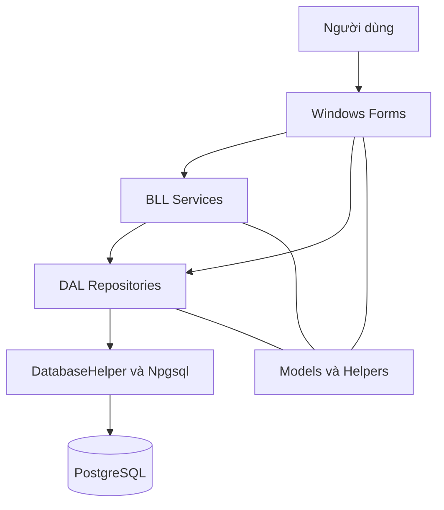

*Hình 2.1. Kiến trúc thành phần theo luồng gọi hiện tại.*

Ưu điểm của cách tổ chức này là các câu SQL và thao tác dữ liệu được tập trung tương đối rõ. Hạn chế là các Form vẫn phụ thuộc nhiều vào DAL, một số điều kiện còn gắn với sự kiện giao diện, và các Service chưa tạo được ranh giới nghiệp vụ thống nhất. Đây là cơ sở cho hướng tái cấu trúc sau này.

## 2.2. Mô hình use case

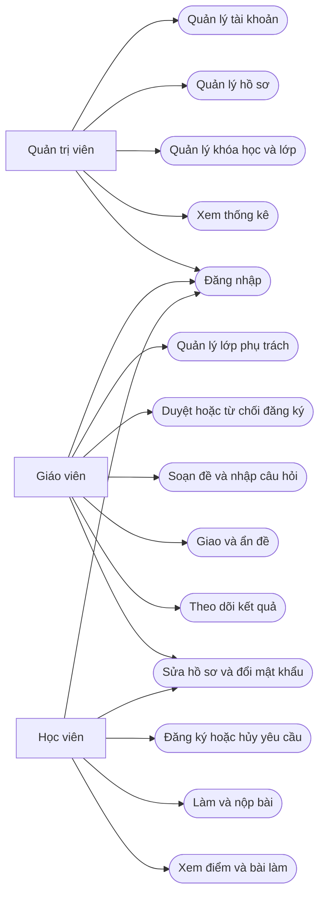

*Hình 2.2. Sơ đồ tác nhân – chức năng; dùng ký pháp luồng để thể hiện quan hệ use case trong Markdown.*

Các thao tác sau đăng nhập phụ thuộc vai trò. Việc “đăng nhập” là tiền điều kiện chung, không có nghĩa người dùng được thực hiện mọi use case. Giáo viên được duyệt yêu cầu thuộc lớp mình phụ trách; học viên được làm bài theo tư cách thành viên lớp và điều kiện của lượt thi.

## 2.3. Đặc tả các use case chính

### 2.3.1. UC01 — Đăng nhập

**Bảng 2.2. Đặc tả đăng nhập**

| Thuộc tính | Nội dung |
|---|---|
| Tác nhân | Mọi người dùng |
| Tiền điều kiện | Ứng dụng truy cập được cơ sở dữ liệu; tài khoản tồn tại |
| Đầu vào | Tên đăng nhập, mật khẩu, lựa chọn ghi nhớ |
| Luồng chính | Kiểm tra nhập liệu → truy vấn tài khoản → xác minh mật khẩu → kiểm tra khóa/vai trò/liên kết → gán Session → mở Form phù hợp |
| Ngoại lệ | Thiếu thông tin, sai mật khẩu, tài khoản khóa, vai trò không hợp lệ, hồ sơ liên kết không xác định hoặc lỗi DB |
| Hậu điều kiện | Phiên cục bộ chứa mã tài khoản, vai trò và mã người dùng |

Đối với dữ liệu cũ, nếu `NguoiDungID` không hợp lệ, DAL tìm liên kết ngược từ bảng hồ sơ theo `TaiKhoanID` và chỉ sử dụng khi xác định được một hồ sơ duy nhất.

### 2.3.2. UC02 — Tạo tài khoản và liên kết hồ sơ

**Bảng 2.3. Đặc tả tạo tài khoản**

| Thuộc tính | Nội dung |
|---|---|
| Tác nhân | Quản trị viên |
| Tiền điều kiện | Đã đăng nhập; có hồ sơ chưa được gán nếu là giáo viên/học viên |
| Luồng chính | Chọn vai trò → chọn hồ sơ → nhập thông tin → xác nhận → kiểm tra tên và liên kết → ghi tài khoản và cập nhật hồ sơ trong transaction |
| Ngoại lệ | Trùng tên, hồ sơ không tồn tại, hồ sơ đã có tài khoản hoặc yêu cầu đồng thời |
| Hậu điều kiện | Tài khoản được gắn đúng hồ sơ; hồ sơ không còn trong danh sách chưa gán |

Vai trò Admin không cần hồ sơ giáo viên hoặc học viên. Hồ sơ đã liên kết với tài khoản bị khóa vẫn được coi là đã có tài khoản.

### 2.3.3. UC03 — Đăng ký và duyệt lớp

**Bảng 2.4. Đặc tả đăng ký lớp**

| Thuộc tính | Nội dung |
|---|---|
| Tác nhân | Học viên và giáo viên phụ trách |
| Tiền điều kiện | Lớp đang mở, học viên tồn tại; khi duyệt phải còn chỗ |
| Luồng chính | Học viên chọn lớp và xác nhận → lưu Chờ duyệt → giáo viên xem yêu cầu → kiểm tra lớp/sĩ số/đơn → đổi Đã duyệt |
| Luồng thay thế | Giáo viên từ chối; học viên hủy yêu cầu khi còn được phép |
| Ngoại lệ | Đăng ký trùng, lớp đầy/đóng, sai mã đơn hoặc giáo viên không phụ trách |
| Hậu điều kiện | Đăng ký đã duyệt tạo tư cách thành viên; không ghi đè lớp chính đang có |

Khi học viên chưa có lớp chính, thao tác duyệt có thể bổ sung lớp chính. Nếu đã có lớp chính, lớp mới được ghi nhận qua `DangKyLop`. Quản trị viên có luồng xếp lớp trực tiếp lúc tạo mới hồ sơ; đây là luồng riêng với duyệt yêu cầu của giáo viên.

### 2.3.4. UC04 — Nhập câu hỏi Excel

**Bảng 2.5. Đặc tả nhập câu hỏi**

| Thuộc tính | Nội dung |
|---|---|
| Tác nhân | Giáo viên |
| Tiền điều kiện | Có tài khoản hợp lệ và đề được phép chỉnh sửa |
| Đầu vào | Tệp `.xlsx`/`.xls` với đủ sáu cột câu hỏi |
| Luồng chính | Chọn tệp → tìm tiêu đề → đọc và kiểm tra toàn bộ dòng → kiểm tra quyền/trạng thái đề → ghi câu hỏi và cập nhật số câu |
| Ngoại lệ | Sai định dạng, thiếu/trùng cột, đáp án lỗi, quá giới hạn, sai quyền hoặc lỗi ghi |
| Hậu điều kiện | Ghi đầy đủ dữ liệu hợp lệ hoặc không nhập phần nào khi có lỗi |

### 2.3.5. UC05 — Giao đề thi

**Bảng 2.6. Đặc tả giao đề**

| Thuộc tính | Nội dung |
|---|---|
| Tác nhân | Giáo viên |
| Tiền điều kiện | Sở hữu đề có câu hỏi, phụ trách lớp nhận, tài khoản còn hoạt động |
| Luồng chính | Chọn đề/môn/lớp/thời gian → xác nhận → khóa đề nguồn → tạo bản ghi lượt mới → sao chép câu hỏi → cập nhật số câu → commit |
| Ngoại lệ | Không có câu hỏi, lớp không phù hợp quyền, thời gian không hợp lệ, sao chép thất bại |
| Hậu điều kiện | Một lượt có mã và câu hỏi riêng được tạo; lượt cũ không bị ghi đè |

Trên Form giáo viên, hạn nộp truyền xuống là thời điểm giao cộng bảy ngày. Cơ chế giao mới sử dụng `TaoLanGiaoDeThi`; không được mô tả nhầm là cập nhật một đề duy nhất cho tất cả các lớp.

### 2.3.6. UC06 — Làm và nộp bài

**Bảng 2.7. Đặc tả làm bài**

| Thuộc tính | Nội dung |
|---|---|
| Tác nhân | Học viên |
| Tiền điều kiện | Có quyền lớp, đề mở/còn hạn, có câu hỏi, thời gian dương, chưa nộp |
| Luồng chính | Kiểm tra quyền → tải câu hỏi → chọn đáp án/chuyển câu → xác nhận nộp hoặc hết giờ → DAL chấm và ghi → hiển thị kết quả |
| Ngoại lệ | Sai quyền, đã nộp, đề bị ẩn hoặc lỗi DB lúc ghi |
| Hậu điều kiện | Một kết quả cùng chi tiết của toàn bộ câu hỏi được lưu trong transaction |

Khi lỗi lưu, Form giữ lại trạng thái để thử lại thay vì đóng và mất ngay dữ liệu. Cơ chế này không tương đương lưu nháp bền vững khi tiến trình bị tắt.

### 2.3.7. UC07 — Ẩn đề và giữ lịch sử

**Bảng 2.8. Đặc tả ẩn đề**

| Thuộc tính | Nội dung |
|---|---|
| Tác nhân | Giáo viên sở hữu đề |
| Tiền điều kiện | Tài khoản và quyền sở hữu hợp lệ |
| Luồng chính | Chọn đề → xác nhận → khóa đề → cập nhật Đã xóa → tải lại danh sách |
| Hậu điều kiện | Đề bị ẩn khỏi giao bài và không nhận bài mới; metadata, câu hỏi, điểm và chi tiết cũ được giữ |
| Ngoại lệ | Sai quyền hoặc lỗi cập nhật; giao dịch không hoàn tất |

DAL còn overload xóa cũ, chỉ cho phép xóa đề chưa giao và chưa có bài làm. Nút xóa hiện tại trên Form giáo viên gọi overload có thông tin tài khoản và giáo viên để xử lý giữ lịch sử.

## 2.4. Thiết kế cơ sở dữ liệu

### 2.4.1. Các thực thể

**Bảng 2.9. Các thực thể dữ liệu**

| Bảng | Vai trò |
|---|---|
| TaiKhoan | Thông tin đăng nhập, vai trò, liên kết người dùng và trạng thái khóa |
| GiaoVien | Hồ sơ giáo viên |
| HocSinh | Hồ sơ học viên và lớp chính |
| KhoaHoc | Danh mục khóa học |
| LopHoc | Thông tin lớp, giáo viên, khóa học, lịch và sức chứa |
| DangKyLop | Yêu cầu và tư cách tham gia lớp qua đăng ký |
| DeThi | Đề nháp và từng lượt giao |
| CauHoi | Nội dung, bốn phương án, đáp án đúng và thứ tự |
| KetQuaThi | Điểm, số câu đúng và thời điểm nộp |
| ChiTietBaiLam | Đáp án học viên chọn cho từng câu |

### 2.4.2. Quan hệ nghiệp vụ

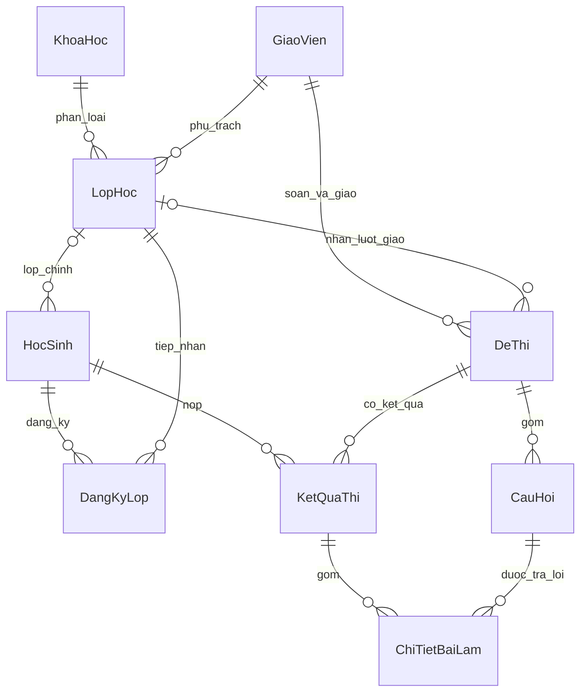

*Hình 2.3. Quan hệ nghiệp vụ giữa các bảng.*

Liên kết tài khoản có tính phụ thuộc vai trò: `TaiKhoan.NguoiDungID` tham chiếu logic đến mã giáo viên hoặc học viên, còn bảng hồ sơ có `TaiKhoanID` cho liên kết ngược. Không có một FK đa hình duy nhất thể hiện đồng thời hai bảng đích. Chính vì vậy, mã nguồn cần kiểm tra vai trò và tính duy nhất của liên kết.

### 2.4.3. Ràng buộc vật lý và giới hạn

Cấu trúc PostgreSQL trong `CreateDataBase.Init` khai báo khóa chính identity cho mười bảng, tên đăng nhập duy nhất và một số trường NOT NULL. Phần tạo bảng này **chưa khai báo FOREIGN KEY** cho các quan hệ nêu trên. Báo cáo phân biệt các liên kết nghiệp vụ với ràng buộc thực sự được DB cưỡng chế; không khẳng định cơ sở dữ liệu đã đầy đủ khóa ngoại hoặc UNIQUE chống nộp lặp.

Hiện tại nhiều quy tắc được thực hiện bằng kiểm tra và khóa trong DAL. Điều này có tác dụng khi các thao tác đi qua các luồng ứng dụng tương ứng, nhưng không bảo vệ đầy đủ trước thao tác SQL trực tiếp hoặc công cụ ngoài ứng dụng. Bổ sung FK, unique phù hợp và quy trình nâng cấp schema là một hướng cải tiến.

Các tệp `Database/Scripts/01_CreateDatabase.sql`, `02_SeedData.sql`, `Full_Setup_Database.sql` vẫn chứa cú pháp SQL Server như `GO`, `IDENTITY`, `GETDATE`. Nguồn dùng để mô tả kiểu PostgreSQL trong báo cáo là chuỗi `createTablesSql` trong `Database/CreateDataBase.cs`. Không sử dụng các script SQL Server này như hướng dẫn khởi tạo PostgreSQL nguyên trạng.

## 2.5. Quy tắc và trạng thái nghiệp vụ

**Bảng 2.10. Quy tắc nghiệp vụ**

| Mã | Quy tắc |
|---|---|
| R01 | Một hồ sơ đã có tài khoản không được gán tài khoản mới, kể cả tài khoản đang khóa |
| R02 | Không khóa tài khoản có vai trò Admin bằng luồng khóa; vẫn có thể mở lại Admin đã khóa trước đó |
| R03 | Sĩ số được tính từ hợp lớp chính và đăng ký Đã duyệt, không đếm trùng học viên |
| R04 | Đăng ký/duyệt phải kiểm tra lớp đang mở và sức chứa tại thời điểm ghi |
| R05 | Duyệt thêm lớp không ghi đè lớp chính đang có |
| R06 | Học viên chỉ tự hủy đăng ký khi luồng DAL cho phép; không tự hủy tư cách đã duyệt |
| R07 | Mã lớp xác định quyền; hai lớp trùng tên vẫn độc lập |
| R08 | Giao đề tạo bản sao độc lập của metadata và câu hỏi |
| R09 | Không sửa câu hỏi trên lượt đã giao theo cơ chế khóa đề hiện tại |
| R10 | Một học viên chỉ nộp một lần cho một mã lượt đề qua luồng nộp bài |
| R11 | Điểm được chấm từ đáp án trong DB, không tin điểm do giao diện truyền vào |
| R12 | Ẩn đề theo luồng có quyền phải giữ kết quả và chi tiết bài làm |

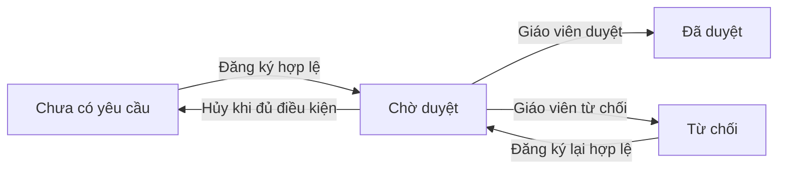

*Hình 2.4. Các chuyển trạng thái đăng ký chính.*

Đăng ký lại sau từ chối có thể cập nhật bản ghi gần nhất thay vì luôn chèn dòng mới. Khi hủy, DAL xóa đăng ký theo điều kiện; không có trạng thái “Đã hủy” bắt buộc phải được lưu.

Đề nháp thường có trạng thái `Chưa giao`. Lượt mới được tạo với trạng thái `Đang mở`; thao tác xóa có quyền đặt `Đã xóa`. Các nhãn `Hết hạn` hoặc `Đã làm` trong danh sách học viên có thể được tính từ hạn nộp và sự tồn tại kết quả, không nhất thiết là giá trị được lưu trong `DeThi.TrangThai`.

Đóng đăng ký lớp không đồng nghĩa đóng đề thi. Học viên đã có quyền lớp vẫn có thể làm các đề phù hợp điều kiện. Quyền xem đề không phụ thuộc việc được duyệt trước hay sau ngày giao; học viên được duyệt sau vẫn thấy lượt giao cũ của lớp.

## 2.6. Biểu đồ tuần tự

### 2.6.1. Đăng nhập

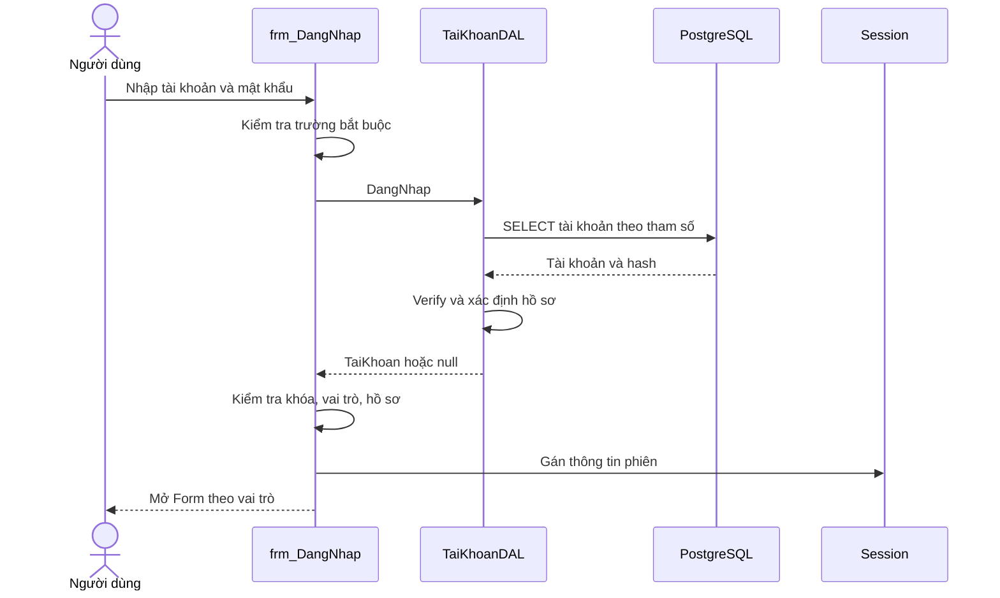

*Hình 2.5. Trình tự đăng nhập thành công; các nhánh lỗi trả thông báo và dừng.*

### 2.6.2. Giao đề

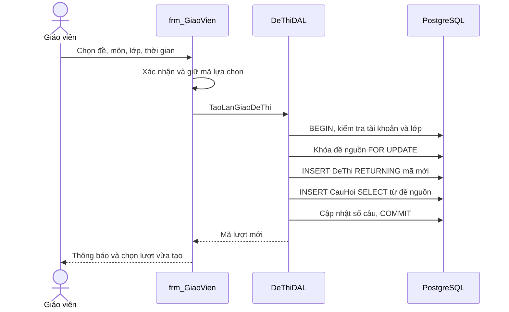

*Hình 2.6. Giao đề bằng bản sao độc lập; lỗi trước commit làm rollback.*

### 2.6.3. Nộp bài

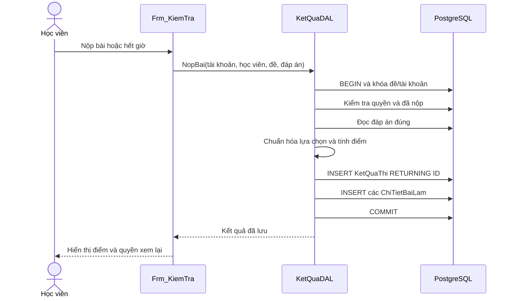

*Hình 2.7. Chấm và ghi bài làm trong cùng giao dịch.*

## 2.7. Thiết kế điều hướng và giao diện

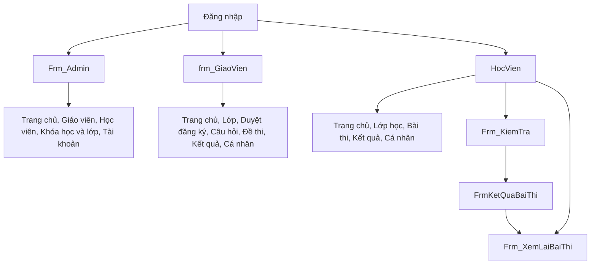

*Hình 2.8. Điều hướng chức năng tổng quát.*

Các màn hình sử dụng tab và menu tương ứng theo vai trò. Các control tĩnh được khai báo trong `.Designer.cs` và tài nguyên nằm trong `.resx`. Dữ liệu, trạng thái nút, thông báo, timer và màu đúng/sai được cập nhật khi chạy.

Thiết kế cần hỗ trợ trạng thái rỗng và lỗi truy vấn. Một bảng trống không nên bị hiểu nhầm là lỗi, và dữ liệu cũ không nên tiếp tục được trình bày như dữ liệu mới sau lần tải thất bại. Các bảng đã khai báo cột cần giữ `DataPropertyName` và tiêu đề đã thiết kế.

## 2.8. Biểu đồ luồng dữ liệu (DFD)

Biểu đồ luồng dữ liệu mô tả dữ liệu đi vào, được xử lý, lưu trữ và trả về trong hệ thống. Các sơ đồ dưới đây dùng Mermaid để thể hiện DFD logic dựa trên chức năng và bảng dữ liệu của mã nguồn master. Hình chữ nhật biểu diễn tác nhân ngoài; hình bo tròn biểu diễn tiến trình; hình trụ biểu diễn kho dữ liệu. Mũi tên được đặt tên bằng dữ liệu truyền, không biểu diễn thứ tự thực thi hay tín hiệu điều khiển.

Quy ước trong báo cáo: mức ngữ cảnh biểu diễn toàn hệ thống bằng tiến trình 0; mức 0 phân rã thành các tiến trình 1.0–6.0; mức 1 tiếp tục phân rã một tiến trình nghiệp vụ. Kho dữ liệu là nhóm bảng logic, không phải các database hoặc dịch vụ độc lập. Một số giáo trình gọi sơ đồ ngữ cảnh là DFD mức 0; khi áp dụng quy định của khoa cần thống nhất cách gọi trong toàn báo cáo.

### 2.8.1. DFD mức ngữ cảnh

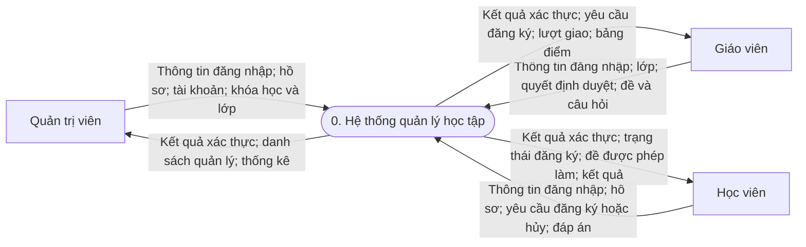

*Hình 2.9. DFD mức ngữ cảnh của hệ thống quản lý học tập.*

Ba tác nhân trao đổi dữ liệu với cùng một hệ thống desktop có lưu trữ PostgreSQL. PostgreSQL là kho dữ liệu nội bộ nên không được đặt như tác nhân ngoài tại sơ đồ ngữ cảnh. Giáo viên cung cấp quyết định duyệt đăng ký, còn quản trị viên quản lý dữ liệu nền và có luồng xếp lớp trực tiếp khi tạo học viên.

### 2.8.2. DFD mức 0

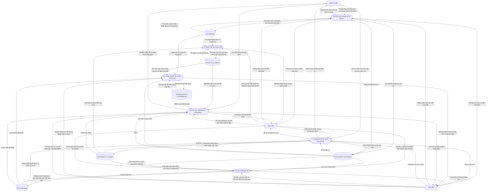

*Hình 2.10. DFD mức 0 phân chia thành sáu tiến trình và sáu kho dữ liệu logic.*

Tiến trình 1.0 cung cấp kết quả xác thực và quản lý tài khoản. Khi thực hiện thao tác sau đăng nhập, định danh tài khoản được lấy từ Session và một số luồng tiếp tục đối chiếu DB tại DAL. Sơ đồ không có nghĩa tiến trình 1.0 là một dịch vụ xác thực riêng hoặc tất cả phương thức đều áp dụng cơ chế phân quyền giống nhau.

Dữ liệu câu hỏi ở D5 gồm cả đáp án chuẩn nhưng luồng này phục vụ xử lý nội bộ. Đầu ra cho người học khi bắt đầu thi là nội dung được phép hiển thị; việc nêu đáp án chuẩn trên mũi tên kho–tiến trình không có nghĩa hệ thống cung cấp đáp án đúng như một tính năng trước khi nộp.

### 2.8.3. DFD mức 1 — tiến trình 3.0 xử lý đăng ký lớp

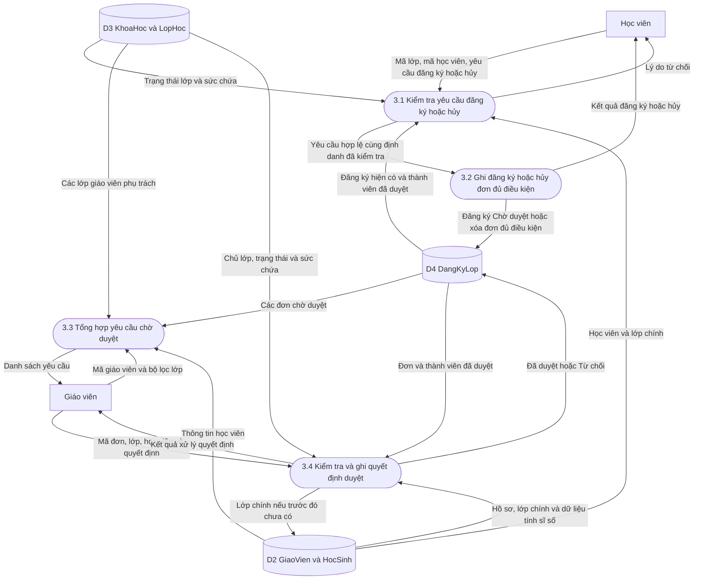

*Hình 2.11. DFD mức 1 của đăng ký và duyệt lớp.*

Sơ đồ phân rã đúng các dữ liệu ra/vào của tiến trình 3.0. Các thành phần 3.1 và 3.2 là phân chia logic để giải thích; trong mã, kiểm tra và ghi được thực hiện trong transaction tại DAL, không tách thành hai thao tác độc lập thiếu khóa. Trạng thái sau duyệt được học viên đọc lại khi tải danh sách; hệ thống không có thông báo đẩy kết quả duyệt theo thời gian thực.

### 2.8.4. DFD mức 1 — tiến trình 5.0 làm và nộp bài

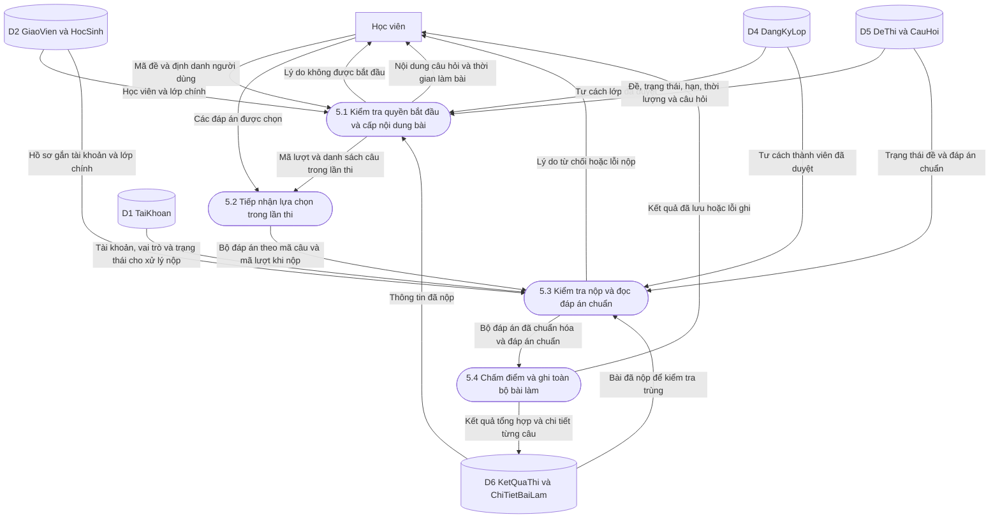

*Hình 2.12. DFD mức 1 của làm bài và nộp bài.*

Tiến trình 5.2 giữ lựa chọn trong bộ nhớ của Form; không vẽ thêm kho lưu nháp trong DB vì hệ thống chưa có chức năng đó. Tiến trình 5.3 và 5.4 là hai phần logic của `KetQuaDAL.NopBai`, cùng nằm trong transaction khi kiểm tra và ghi. Hạn nộp được kiểm tra khi mở phòng thi và giới hạn đồng hồ; điều kiện SQL nộp bài hiện không kiểm tra lại hạn theo cùng cách, nên sơ đồ không khẳng định có bản ghi lần thi phía server kiểm soát thời gian tuyệt đối.

Đầu ra lỗi ghi không phải kết quả thành công. Chỉ sau commit, mã kết quả và điểm đã lưu mới được coi là đầu ra hoàn thành; chi tiết chưa trả lời vẫn được ghi để tái hiện đầy đủ bài làm.

# CHƯƠNG 3. TRIỂN KHAI HỆ THỐNG

## 3.1. Môi trường và cấu trúc mã nguồn

Ứng dụng chính là project kiểu .NET Framework cũ, có `TargetFrameworkVersion` bằng `v4.8` và kiểu đầu ra `WinExe`. Phụ thuộc được quản lý bằng `packages.config` và các `HintPath` trỏ đến thư mục `packages`. Các file biên dịch và tài nguyên được liệt kê tường minh trong `.csproj`.

**Bảng 3.1. Cấu trúc mã nguồn**

| Đường dẫn | Nội dung |
|---|---|
| `Program.cs` | Điểm khởi động STAThread, theme chung và Form đăng nhập |
| `Forms/Auth` | Đăng nhập và ghi nhớ |
| `Forms/Admin` | Quản trị dữ liệu và tài khoản |
| `Forms/GiaoVien` | Lớp, duyệt, câu hỏi, giao đề và kết quả |
| `Forms/HocSinh` | Học viên và xem lại bài |
| `Forms/KiemTra` | Phòng thi và kết quả sau nộp |
| `BLL/Services`, `BLL/Interfaces` | Service và một số interface |
| `DAL/Repositories` | Các lớp DAL theo nhóm dữ liệu |
| `Models/Entities` | Các mô hình dữ liệu |
| `Database` | DatabaseHelper và mã khởi tạo |
| `Helpers` | Tiện ích dùng chung |
| `Templates` | Tệp câu hỏi mẫu |
| `tests` | Kiểm thử tự động và smoke test |
| `docs` | Giải thích nghiệp vụ, thay đổi và cách kiểm tra |

## 3.2. Khởi động và cấu hình kết nối

`Program.Main` bật visual styles, thiết lập tương thích hiển thị, cấu hình `MaterialSkinManager` với theme sáng và màu chủ đạo, sau đó gọi `Application.Run(new frm_DangNhap())`. Theme được quản lý dùng chung thay vì mỗi Form tự đặt lại khi mở.

`DatabaseHelper.ConnectionString` lấy dữ liệu từ `ConfigurationManager.ConnectionStrings["ChuoiKetNoi"]`. Form đăng nhập gọi kiểm tra kết nối bằng cách mở NpgsqlConnection và chạy `SELECT 1`. Đây là phép kiểm tra khả năng kết nối, không phải bước tự tạo schema.

Dòng `CreateDataBase.Init()` trong `Program.Main` đang bị comment. Vì vậy không thể hướng dẫn người dùng rằng mở ứng dụng sẽ tự động tạo bảng và dữ liệu mẫu. Schema cần được chuẩn bị trước. Ngoài ra, lớp khởi tạo có phần mã seed cũ; không nên coi toàn bộ các hàm seed cũ là script PostgreSQL đã được kiểm chứng chỉ vì phần `createTablesSql` hợp lệ.

## 3.3. Truy cập dữ liệu và xử lý giao dịch

`DatabaseHelper` cung cấp các hàm truy vấn DataTable, lấy scalar, cập nhật và hỗ trợ transaction. Các DAL cũng mở kết nối và giao dịch riêng khi cần kiểm tra/khóa nhiều bước. Kết nối, command và reader được đặt trong các khối `using` để giải phóng tài nguyên.

Các truy vấn truyền giá trị bằng `NpgsqlParameter`, ví dụ mã lớp, mã học viên hoặc tên đăng nhập. Một số câu SQL được xây dựng theo vai trò hay điều kiện lọc; việc dùng chuỗi SQL trong mã không đồng nghĩa toàn bộ truy vấn là nội suy dữ liệu từ người dùng. Cần đánh giá từng điểm ghép chuỗi thay vì kết luận chung chỉ từ hình thức.

### 3.3.1. Tạo tài khoản

`ThemTaiKhoan` sử dụng giao dịch, khóa tên đăng nhập chuẩn hóa bằng `pg_advisory_xact_lock(hashtext(LOWER(@ten)))` và khóa hồ sơ được gán bằng `FOR UPDATE`. Sau khi kiểm tra trùng tên và liên kết, dữ liệu tài khoản cùng hồ sơ được cập nhật trong một transaction. Cách xử lý này hạn chế hai yêu cầu cùng tạo liên kết cho một người.

### 3.3.2. Kiểm soát sĩ số

Các luồng đăng ký, duyệt và thêm hồ sơ kèm xếp lớp khóa bản ghi lớp để kiểm tra sức chứa trong giao dịch. Số học viên thực tế là hợp học viên có lớp chính tương ứng và người có đăng ký Đã duyệt. Không đếm riêng hai nguồn rồi cộng vì có thể trùng người. Khi sửa lớp, hệ thống không cho giảm sức chứa xuống thấp hơn sĩ số thực tế.

### 3.3.3. Tạo lượt giao và bảo vệ lịch sử

`TaoLanGiaoDeThi` kiểm tra tài khoản giáo viên và lớp phụ trách, khóa đề nguồn, chèn đề mới và sao chép câu hỏi. Nếu sao chép thất bại, transaction không commit. Các thao tác sửa/nhập câu hỏi dùng cơ chế khóa đề tương ứng để tránh sao chép một bộ câu hỏi đang cập nhật dở.

### 3.3.4. Nộp bài nguyên tử

`KetQuaDAL.NopBai` khóa đề, kiểm tra tài khoản/hồ sơ/quyền lớp và truy vấn xem đã có kết quả hay chưa. Đáp án chuẩn được đọc từ DB, đáp án chọn được chuẩn hóa về A–D; giá trị không hợp lệ được coi như chưa chọn. Hệ thống tạo chi tiết cho từng câu trong đề, kể cả câu chưa trả lời.

Điểm được tính theo công thức:

**Điểm = Round(Số câu đúng × 10 / Tổng số câu thực tế, 2).**

Việc tính sử dụng số thập phân trong đoạn chấm. `KetQuaThi` và mọi dòng `ChiTietBaiLam` được ghi trong một transaction. Các hàm lưu rời cũ vẫn tồn tại trong DAL nhưng luồng nộp bài đang xét dùng phương thức nguyên tử; không nên đánh đồng hai cơ chế.

## 3.4. Xác thực, phiên đăng nhập và phân quyền

### 3.4.1. Xác minh mật khẩu

`TaiKhoanDAL.DangNhap` truy vấn theo tên đăng nhập và kiểm tra mật khẩu bằng `Passwords.Verify`. Hàm băm sử dụng SHA-256 và biểu diễn kết quả bằng chuỗi hex. Để tương thích dữ liệu cũ, nếu giá trị lưu không có dạng chuỗi hex 64 ký tự, mã còn cho phép so sánh với mật khẩu thuần cũ. Không chấp nhận nhập trực tiếp chuỗi hash làm mật khẩu của bản ghi đã nhận diện là hash.

Mật khẩu mới và đổi mật khẩu được băm trước khi lưu. Tuy nhiên SHA-256 trực tiếp không có salt và không có tham số chi phí nên chưa phù hợp với yêu cầu bảo vệ mật khẩu hiện đại. Hướng cải tiến là chuyển sang thuật toán chuyên dụng cùng cơ chế chuyển đổi dữ liệu cũ.

### 3.4.2. Session và điều hướng

`Session` là lớp static lưu `TaiKhoanID`, `TenDangNhap`, `VaiTro`, `NguoiDungID` và `HoTen`. Đây là trạng thái trong tiến trình desktop, không phải session phía server, JWT hoặc cookie. Các thuộc tính `IsAdmin`, `IsGiaoVien`, `IsHocSinh` hỗ trợ kiểm tra vai trò; `Clear` xóa dữ liệu phiên khi cần.

Sau khi xác thực, Form đăng nhập kiểm tra trạng thái khóa, vai trò hợp lệ và liên kết hồ sơ rồi mở Form tương ứng. Hệ thống truy vấn tên người dùng để hiển thị; nếu truy vấn tên không thành công có thể giữ tên đăng nhập.

### 3.4.3. Kiểm tra quyền tại DAL

Một số thao tác quan trọng nhận cả mã tài khoản và mã người dùng để kiểm tra lại trong DB: tạo lượt giao, nhập câu hỏi, nộp bài, đổi mật khẩu cá nhân và ẩn đề. Duyệt đăng ký trên Form truyền mã giáo viên để ràng buộc lớp phụ trách. Việc kiểm tra ở DAL giúp hạn chế quyết định dựa hoàn toàn vào dữ liệu bảng đã tải trước đó.

Mức kiểm tra quyền không đồng nhất ở mọi phương thức: vẫn có overload cũ với tham số mặc định hoặc thao tác quản trị dựa vào luồng Form. Báo cáo không khẳng định tất cả phương thức DAL là một ranh giới bảo mật tuyệt đối. Ứng dụng desktop kết nối DB trực tiếp cũng có yêu cầu bảo vệ thông tin kết nối tại máy khách.

### 3.4.4. Ghi nhớ đăng nhập

Thông tin ghi nhớ được lưu trong `remember.dat` tại `Application.StartupPath`. Mã xử lý dùng Base64 cho dữ liệu ghi nhớ. Base64 là cách biểu diễn dữ liệu có thể đảo ngược, không phải mã hóa bảo mật. Chức năng có giá trị tiện dụng nhưng cần được thay bằng Windows Credential Manager hoặc DPAPI nếu tiếp tục lưu thông tin nhạy cảm tại máy.

## 3.5. Chức năng quản trị viên

### 3.5.1. Thống kê tổng quan

Dashboard hiển thị tổng số học viên, giáo viên, khóa học và lớp học. Biểu đồ lấy tối đa sáu khóa học theo số học viên; số lượng được đếm DISTINCT từ tư cách thành viên hợp lệ. Danh sách lớp mới lấy tối đa năm lớp theo `LopHocID` giảm dần vì schema không có trường thời điểm tạo lớp. Không diễn giải “mới nhất” thành sắp theo ngày bắt đầu.

Danh sách được làm mới khi thực hiện thao tác tương ứng hoặc quay về tab. Hệ thống không dùng kênh cập nhật thời gian thực. Một số mô tả cũ trong docs còn nói thống kê chỉ theo lớp chính; truy vấn hiện tại đã xét cả đăng ký Đã duyệt.

### 3.5.2. Hồ sơ giáo viên và học viên

Quản trị viên thêm, sửa, tìm kiếm và xóa hồ sơ theo điều kiện. Khi thêm học viên, có thể chọn lớp đang mở và còn chỗ. Tạo hồ sơ và xếp lớp được thực hiện cùng giao dịch để không để lại hồ sơ dở dang khi lớp không còn hợp lệ. Ô xếp lớp lúc tạo mới không được hiểu là chức năng tự do chuyển lớp khi sửa thông tin cá nhân.

Các thao tác xóa kiểm tra dữ liệu liên quan để hạn chế mất lịch sử hoặc tạo mồ côi. Do schema chưa có đầy đủ FK, kiểm tra này vẫn cần được củng cố ở DB trong phiên bản sau.

### 3.5.3. Khóa học và lớp

Khóa học gồm tên và mô tả. Lớp liên kết khóa học và giáo viên, đồng thời chứa lịch học, ngày bắt đầu/kết thúc, sức chứa và trạng thái. Luồng sửa thông tin cơ bản tại Admin sử dụng phương thức riêng để giữ các trường lịch/ngày không xuất hiện trong phần nhập liệu đó.

### 3.5.4. Tài khoản

Khi chọn vai trò giáo viên hoặc học viên, danh sách “Gán cho” chỉ hiển thị hồ sơ chưa có tài khoản. Đổi vai trò xóa lựa chọn cũ để tránh ghép sai mã giữa hai bảng. Khóa tài khoản Admin bị chặn cả trong giao diện và điều kiện SQL của luồng khóa; tài khoản Admin đã bị khóa từ trước vẫn có thể được mở lại.

Nút đặt lại mật khẩu hiện gọi DAL với mật khẩu mặc định `123456`. Đây là hành vi hiện tại của sản phẩm, không phải khuyến nghị sử dụng lâu dài. Cần yêu cầu đổi mật khẩu sau đặt lại và thay cơ chế mặc định trong hướng phát triển.

## 3.6. Chức năng giáo viên

### 3.6.1. Trang chủ và lớp phụ trách

Trang chủ lấy tổng số lớp, số học viên, số yêu cầu chờ duyệt và số bài thi đang mở. Học viên được đếm DISTINCT để không lặp nếu tham gia nhiều lớp cùng giáo viên. Bảng tổng hợp kết quả gần đây nhóm theo mã đề, hiển thị số bài nộp và điểm trung bình. Điểm 0 được tính; giá trị thiếu điểm không tự biến thành 0.

Danh sách lớp phụ trách được dùng cho quản lý lớp, lọc yêu cầu và chọn lớp nhận bài. Nhận diện lớp bằng mã, không chỉ bằng tên hoặc môn, giúp phân biệt các lớp trùng tên.

### 3.6.2. Duyệt và đóng đăng ký

Giáo viên duyệt/từ chối yêu cầu thuộc lớp mình phụ trách. Duyệt kiểm tra lại sĩ số trong transaction; không lấy số chỗ còn lại trên màn hình làm căn cứ duy nhất. Khi đóng đăng ký, mã lớp đang chọn được giữ và chỉ cập nhật đúng lớp theo quyền sở hữu. Đóng nhận đăng ký không đóng các đề đã giao.

### 3.6.3. Soạn câu hỏi và chọn đề

Giáo viên tạo đề nháp và bổ sung câu hỏi trực tiếp hoặc từ Excel. Khi tạo lại với tên và môn trùng một đề nháp đang có, helper chọn đề có thể mở lại đề đó để tiếp tục soạn. Đề mới chưa có câu vẫn xuất hiện trong lựa chọn cần thiết; việc kiểm tra số câu thật diễn ra trước giao.

Mỗi câu gồm nội dung, bốn đáp án A–D, đáp án đúng và thứ tự. Luồng sửa chỉ cho đề được phép chỉnh. Thứ tự thêm mới dùng giá trị lớn nhất cộng một để tránh trùng sau khi đã xóa một câu ở giữa. Tổng số câu được cập nhật theo dữ liệu thực tế.

### 3.6.4. Giao nhiều lần và nhiều lớp

Nút giao bài dùng `TaoLanGiaoDeThi`. Một bộ đề có thể được giao lại cho cùng lớp hoặc giao cho các lớp khác nhau, kể cả khi lượt trước đã có kết quả. Mỗi lần tạo mã mới và bộ câu hỏi riêng. Môn học trên lượt mới lấy từ lựa chọn khi xác nhận; đề nguồn và các lượt cũ giữ nguyên.

Form ưu tiên lớp cùng môn khi đổi lựa chọn nhưng vẫn yêu cầu xác định rõ lớp nhận nếu không có lựa chọn phù hợp. Hạn nộp mặc định là bảy ngày kể từ lúc giao. Đây là hạn của lượt giao; thời gian làm bài được chọn riêng và dùng cho đồng hồ phòng thi.

### 3.6.5. Kết quả và đề đã ẩn

Giáo viên xem kết quả theo từng mã đề và lọc dữ liệu hiển thị. Đề Đã xóa vẫn được đưa vào lựa chọn kết quả với nhãn phân biệt để tra cứu lịch sử. Việc xóa trên Form không xóa điểm và câu trả lời đã lưu. Các thông tin thống kê gần đây được tải lại khi quay về trang chủ; chưa có cơ chế push thông báo khi học viên vừa nộp.

## 3.7. Chức năng học viên

### 3.7.1. Trang chủ và quyền thấy đề

Trang chủ dùng nguồn dữ liệu riêng cho các bài còn có thể bắt đầu: thuộc lớp chính hoặc đăng ký đã duyệt, trạng thái mở, còn hạn hoặc không hạn, có câu hỏi, thời gian dương và chưa nộp. Số câu tính từ bảng `CauHoi`, không chỉ dựa vào cột `SoCau`.

Tab Bài thi có thể giữ các lượt hết hạn/đóng để phản ánh lịch sử giao bài, trong khi trang chủ chỉ ưu tiên bài còn làm được. Việc được duyệt sau ngày giao không loại học viên khỏi các bài của lớp. Danh sách được tải lại khi đổi tab, kích hoạt lại cửa sổ hoặc sau một số thao tác; giữ nguyên màn hình không đồng nghĩa dữ liệu tự cập nhật liên tục.

### 3.7.2. Đăng ký và hủy yêu cầu

Học viên lựa chọn lớp và xác nhận đăng ký. Form giữ mã lớp và mã học viên trước khi mở hộp thoại, đồng thời tạm hoãn refresh do activation trong quá trình xác nhận. Điều này tránh đọc lại dòng đã thay đổi và gửi mã 0 sau khi hộp thoại đóng.

DAL kiểm tra lớp, sức chứa và đăng ký trùng trước khi lưu trạng thái Chờ duyệt. Học viên không được tự hủy một lớp đã được duyệt hoặc lớp chính qua luồng hủy yêu cầu. Trường hợp lớp đã đóng cũng có thể bị từ chối hủy theo điều kiện DAL hiện tại.

### 3.7.3. Phòng thi

Trước khi vào phòng thi, ứng dụng đọc lại điều kiện từ DB. `Frm_KiemTra` tải câu hỏi, lưu đáp án lựa chọn trong bộ nhớ và cho phép chuyển câu. Tiến độ thể hiện tỷ lệ câu đã chọn.

Thời điểm kết thúc là thời điểm bắt đầu cộng thời lượng, nhưng bị giới hạn bởi hạn nộp nếu hạn đến sớm hơn. Mỗi tick cập nhật khoảng thời gian còn lại bằng chênh lệch với thời điểm kết thúc, thay vì giảm một biến theo số tick. Khi hết giờ, Form ngừng timer và gọi nộp bài; lựa chọn đáp án sau thời điểm hết giờ bị chặn.

Khi đóng phòng thi, chương trình có luồng xác nhận nộp. Nếu ghi thất bại, trạng thái được giữ để thử lại. Đáp án chưa nộp chỉ tồn tại trong RAM; việc tắt đột ngột tiến trình vẫn có thể làm mất dữ liệu này.

### 3.7.4. Kết quả và xem lại

Sau khi nộp thành công, Form kết quả nhận điểm đã được DAL tính và mã kết quả đã lưu. Người học có thể xem lại bài làm hoặc mở lịch sử từ màn hình học viên. Màn hình xem lại hiển thị lựa chọn và kết quả đúng/sai theo dữ liệu đã lưu. Việc giữ metadata và câu hỏi khi ẩn đề giúp các bài cũ tiếp tục tra cứu được.

### 3.7.5. Hồ sơ và mật khẩu

Học viên cập nhật các trường cá nhân được phép và đổi mật khẩu sau khi xác minh mật khẩu cũ. Validation kiểm tra dữ liệu như email, điện thoại, ngày sinh và mật khẩu mới. Luồng đổi mật khẩu cá nhân kiểm tra tài khoản và trạng thái khi cập nhật, đồng thời xóa thông tin ghi nhớ phù hợp để tránh tự điền mật khẩu cũ.

## 3.8. Nhập câu hỏi Excel

`CauHoiExcelReader` chỉ chấp nhận `.xlsx` và `.xls`, giới hạn dung lượng 20 MB và tối đa 5.000 dòng câu hỏi có dữ liệu. Sáu trường bắt buộc là `NoiDung`, `DapAnA`, `DapAnB`, `DapAnC`, `DapAnD`, `DapAnDung`. Bộ đọc tìm tiêu đề trong tối đa 20 dòng đầu của từng sheet cho đến khi gặp bảng phù hợp; không gộp tự động mọi sheet thành một bộ câu hỏi.

Các dòng hoàn toàn trống được bỏ qua. Nội dung và bốn đáp án phải được cung cấp; từng đáp án không vượt 255 ký tự; đáp án đúng phải là A, B, C hoặc D sau chuẩn hóa. Nếu có lỗi, thông báo nêu sheet và dòng, hiển thị tối đa 15 lỗi đầu cùng số lỗi còn lại. Dữ liệu lỗi không được nhập một phần.

Sau bước đọc, `CauHoiImportDAL.Nhap` tiếp tục kiểm tra tài khoản, chủ sở hữu và trạng thái đề trong DB, khóa đề và ghi dữ liệu trong transaction. Tệp đúng cấu trúc không tự cấp quyền sửa một đề đã giao. Form có sử dụng `Task.Run` cho phần nhập DAL để giảm chặn giao diện trong luồng đó; không suy rộng rằng mọi truy vấn của ứng dụng đều bất đồng bộ.

Hai tệp mẫu trong `Templates` phục vụ hướng dẫn và kiểm tra luồng nhập, trong đó có bộ câu hỏi C# WinForms 20 câu.

## 3.9. Phân trang, nhập ngày và xuất dữ liệu

### 3.9.1. Phân trang

`PagedBindingList` và `DataGridViewPager` hỗ trợ phân trang trên dữ liệu đã được tải về. Đây là phân trang phía ứng dụng; không phải mọi thao tác trang đều gửi `LIMIT/OFFSET` tới PostgreSQL. Khi dữ liệu rất lớn, tải toàn bộ về máy vẫn có thể tạo áp lực bộ nhớ và thời gian tải.

Helper giữ tập dữ liệu gốc để xuất toàn bộ dữ liệu sau lọc/sắp xếp, thay vì chỉ xuất trang đang nhìn thấy. Các cột Designer được giữ với tiêu đề tiếng Việt; cơ chế gán nguồn cần tránh tự sinh thêm cột có tên trường DB.

### 3.9.2. Cập nhật bảng an toàn

Khi WinForms đang chia độ rộng cột Fill, việc gán nguồn/chọn/cuộn lồng trong sự kiện binding có thể gây lỗi layout. Helper cập nhật mô hình trước rồi gộp các thay đổi giao diện bằng `BeginInvoke` khi có handle. Callback cũ được bỏ qua khi handle bị hủy; yêu cầu lựa chọn của nguồn cũ không áp dụng sang nguồn mới.

### 3.9.3. Ngày tháng

`DatePickerInput` và `Validation` hỗ trợ xử lý dữ liệu ngày, bao gồm trạng thái chưa chọn. Việc bảo toàn giá trị NULL và thứ tự ngày/tháng quan trọng với các máy vi-VN/en-US. Không tự gán ngày hiện tại cho ngày sinh đang trống.

### 3.9.4. Xuất dữ liệu

`ExcelExportHelper` hỗ trợ xuất CSV và XML Spreadsheet 2003 mang phần mở rộng `.xls`. Tệp XML này không phải workbook `.xlsx`, cũng không nên mô tả thành tệp nhị phân `.xls` BIFF chỉ dựa vào phần mở rộng. Xuất bảng điểm có định dạng riêng, thông tin người học và thống kê liên quan.

Giá trị số được chuyển theo cách phù hợp khi tạo XML để tránh lỗi điểm `7,5` trên máy Việt Nam bị đọc thành `75`. Việc đọc Excel đầu vào và việc tạo XML Excel đầu ra là hai cơ chế khác nhau.

## 3.10. Xử lý lỗi và cập nhật giao diện

Các luồng xử lý hiển thị thông báo khi kiểm tra dữ liệu hoặc truy vấn thất bại. Những thao tác bật/tắt nút cần được phục hồi khi kết thúc hoặc hủy. Với danh sách trang chủ, khi tải lỗi, dữ liệu cũ được xóa theo luồng tương ứng để tránh người dùng tiếp tục thao tác trên thông tin đã lỗi thời.

Một số vị trí còn hiển thị chi tiết ngoại lệ và một số catch bỏ qua lỗi phụ, chẳng hạn lấy tên hiển thị. Đây là điểm cần hoàn thiện bằng cơ chế log và phân loại thông báo. Không nên bổ sung một catch toàn cục để che lỗi layout mà không xử lý nguyên nhân.

Các truy vấn đồng bộ vẫn tồn tại và có thể chặn UI nếu DB phản hồi chậm. Tách tác vụ khỏi UI cần đi cùng quản lý vòng đời Form, hủy tác vụ và cập nhật control đúng luồng, thay vì chỉ thêm bất đồng bộ một cách cơ học.

## 3.11. Đóng gói và triển khai

Ứng dụng cần được biên dịch trên môi trường có .NET Framework 4.8 targeting tools và khôi phục NuGet đúng phiên bản. Khi triển khai, cần kiểm tra các assembly đi kèm, thư mục Templates và native binaries của SQL Server Types nếu project yêu cầu khi build/chạy. Các package có trong project không thay đổi thực tế rằng DB chính đang là PostgreSQL.

Trước khởi chạy, cơ sở dữ liệu và schema phải tồn tại; `ChuoiKetNoi` trong file cấu hình của chương trình cần trỏ đúng DB. Không đưa thông tin truy cập DB thật vào bản báo cáo công khai. Với nhiều máy trạm, cần xác định quyền tài khoản DB, kết nối mạng và chứng chỉ TLS theo máy chủ sử dụng.

Repository chưa cung cấp một quy trình production hoàn chỉnh với installer, cập nhật tự động, migration có phiên bản, sao lưu/khôi phục và giám sát. Vì vậy báo cáo trình bày triển khai ở mức build, cấu hình và chạy ứng dụng; không khẳng định đã vận hành production.

## 3.12. Minh họa kết quả qua giao diện

**Bảng 3.2. Danh sách hình giao diện cần bổ sung từ ứng dụng Windows**

| Hình | Màn hình cần chụp | Nội dung phân tích |
|---|---|---|
| 3.1 | Đăng nhập | Tài khoản, mật khẩu, ghi nhớ và thông báo lỗi |
| 3.2 | Trang chủ Admin | Bốn số đếm, biểu đồ và lớp gần đây |
| 3.3 | Quản lý hồ sơ | Danh sách, nhập liệu, tìm kiếm và chọn dòng |
| 3.4 | Tạo tài khoản | Vai trò và danh sách hồ sơ chưa gán |
| 3.5 | Khóa học và lớp | Giáo viên, khóa học, sức chứa |
| 3.6 | Trang chủ giáo viên | Thống kê và kết quả gần đây |
| 3.7 | Duyệt đăng ký | Đúng lớp, học viên và trạng thái yêu cầu |
| 3.8 | Câu hỏi và nhập Excel | Nội dung câu, sáu cột đầu vào, thông báo nhập |
| 3.9 | Giao bài | Đề nguồn, lớp nhận, thời gian và lượt mới |
| 3.10 | Trang chủ học viên | Bài còn được làm, lớp đang học |
| 3.11 | Phòng thi | Nội dung, đáp án, chuyển câu và đồng hồ |
| 3.12 | Kết quả và xem lại | Điểm, số câu đúng, đáp án đã chọn |

Các hình này chưa được chụp/xác minh trong phiên Linux. Khi bổ sung, sử dụng dữ liệu thử nghiệm, che thông tin cá nhân và đặt hình ngay sau phần thuyết minh tương ứng. Không thay hình thực bằng mockup rồi ghi là kết quả chạy ứng dụng.

Đoạn thuyết minh dùng sau khi đã bổ sung ảnh: “Hình 3.9 trình bày thao tác giao bài của giáo viên. Lớp nhận được xác định bằng mã lớp và thông tin hiển thị trong danh sách lựa chọn. Sau xác nhận, hệ thống tạo một lượt mới; mã và kết quả các lượt trước được giữ để tra cứu độc lập.”

# CHƯƠNG 4. KIỂM THỬ VÀ ĐÁNH GIÁ

## 4.1. Mục tiêu và chiến lược

Kiểm thử nhằm xác minh quy tắc nghiệp vụ, tính nguyên tử của thao tác ghi và khả năng phòng ngừa lỗi hồi quy. Các tình huống không chỉ bao gồm dữ liệu hợp lệ mà còn có sai quyền, dữ liệu thiếu, lớp đầy/đóng, đề đã giao, lỗi ghi và thao tác đồng thời.

Phương pháp kết hợp kiểm thử logic độc lập, tích hợp PostgreSQL và smoke test các thành phần WinForms. Kiểm thử tự động không thay thế kiểm tra trực tiếp toàn bộ giao diện. Với mỗi kết quả, cần xác định đúng target, số test đã chạy và trường hợp chưa thực hiện.

## 4.2. Môi trường và cơ chế kiểm thử

Các dự án .NET 8 dùng xUnit và liên kết trực tiếp một số file DAL, Models và Helpers của ứng dụng. Test host cung cấp thành phần thay thế tối thiểu cho phụ thuộc WinForms như `Application.StartupPath`, giúp chạy logic trên Linux. Đây không phải chạy toàn bộ chương trình WinForms dưới .NET 8.

Runner `tests/StudentProfile.Tests/run.py` restore project được chọn, tạo container `postgres:16-bookworm`, phát sinh mật khẩu ngẫu nhiên, chờ DB sẵn sàng và truyền `PROFILE_TEST_CONNECTION` cho test. Container chỉ publish cổng vào loopback và được xóa cùng volume do runner tạo trong khối dọn dẹp. Các bài sử dụng schema riêng nhằm tách dữ liệu.

Runner không đọc App.config của ứng dụng và không chạy trên DB làm việc thật. Đây là điều kiện quan trọng để kiểm tra xóa, rollback và đồng thời mà không tác động dữ liệu người dùng.

## 4.3. Các bộ kiểm thử tự động

**Bảng 4.1. Phạm vi kiểm thử**

| Project | Phạm vi |
|---|---|
| Pagination.Tests | Logic danh sách và phân trang |
| StudentProfile.Tests | Hồ sơ, validation, cập nhật và mật khẩu liên quan |
| ApplicationLogic.Tests | Tài khoản, lớp, quyền đề, giao đề, nộp bài, lịch sử, đồng thời và trang chủ |
| Dashboard.Tests | Số đếm, thống kê khóa/lớp và dữ liệu rỗng |
| ExcelImport.Tests | Đọc tệp thật, kiểm tra cấu trúc, nhập DB và rollback |
| Pagination.SmokeTests | DataGridView thật, binding, Fill, phân trang, ngày và xuất dữ liệu |
| StudentRegistration.SmokeTests | Handler đăng ký/hủy trước activation/rebind, với dialog và DAL test double |

`StudentRegistration.SmokeTests` trích handler từ Form thật bằng `generate.py`. Đây là kiểm tra handler và vòng đời giao diện có điều khiển, không phải kiểm thử end-to-end đầy đủ từ hộp thoại tới PostgreSQL. Các luồng DB thật tương ứng nằm ở bộ ApplicationLogic.

## 4.4. Kết quả đã thực hiện

**Bảng 4.2. Kết quả tại commit được khảo sát**

| Bộ kiểm thử | Tổng | Đạt | Thất bại | Bỏ qua |
|---|---:|---:|---:|---:|
| Pagination.Tests | 19 | 19 | 0 | 0 |
| StudentProfile.Tests | 29 | 29 | 0 | 0 |
| ApplicationLogic.Tests | 144 | 144 | 0 | 0 |
| Dashboard.Tests | 7 | 7 | 0 | 0 |
| ExcelImport.Tests | 29 | 29 | 0 | 0 |
| **Tổng** | **228** | **228** | **0** | **0** |

Các kết quả này được ghi nhận trong lần thiết lập môi trường cùng cuộc hội thoại tại commit `f8d6a5f3dc0aea88229a900939178e31c3bd7006`, sử dụng .NET SDK 8.0.419 và PostgreSQL 16. Tracked files không thay đổi sau bước thiết lập và container kiểm thử được dọn sạch.

Hai smoke project, build ứng dụng đầy đủ và kiểm tra giao diện ReaLTaiizor trên Windows **không được chạy trong lần xác minh này**. Một số tài liệu trong `docs` ghi nhận build/smoke và số test của các phiên bản trước; báo cáo không cộng những kết quả đó vào 228 test hay xem chúng là kết quả mới của phiên hiện tại.

## 4.5. Danh mục test case chức năng

Bảng dưới là kế hoạch kiểm tra thủ công trên Windows. Cột trạng thái để “Chưa chạy thủ công” nhằm phân biệt với bằng chứng kiểm thử tự động ở trên.

**Bảng 4.3. Các test case chức năng đề xuất**

| Mã | Tình huống và thao tác | Kết quả mong đợi | Trạng thái |
|---|---|---|---|
| TC01 | Đăng nhập hợp lệ từng vai trò | Mở đúng Form và hiển thị đúng người | Chưa chạy thủ công |
| TC02 | Bỏ trống tên hoặc mật khẩu | Báo trường thiếu, không mở Form nghiệp vụ | Chưa chạy thủ công |
| TC03 | Sai mật khẩu hoặc tài khoản khóa | Từ chối truy cập | Chưa chạy thủ công |
| TC04 | Giáo viên/học viên không có liên kết duy nhất | Báo lỗi liên kết | Chưa chạy thủ công |
| TC05 | Tạo tài khoản cho hồ sơ chưa gán | Liên kết đúng, hồ sơ biến mất khỏi lựa chọn | Chưa chạy thủ công |
| TC06 | Gán hồ sơ đã có tài khoản khóa | Không cho gán trùng | Chưa chạy thủ công |
| TC07 | Khóa Admin | Bị chặn; mở khóa Admin cũ vẫn được phép | Chưa chạy thủ công |
| TC08 | Thêm học viên vào lớp đang mở còn chỗ | Tạo đủ hồ sơ và tư cách lớp | Chưa chạy thủ công |
| TC09 | Thêm vào lớp đầy/đóng | Từ chối, không để hồ sơ dở dang | Chưa chạy thủ công |
| TC10 | Sửa lớp bằng Admin | Giữ lịch/ngày không được chỉnh ở Form đó | Chưa chạy thủ công |
| TC11 | Giảm sức chứa dưới sĩ số thật | Từ chối cập nhật | Chưa chạy thủ công |
| TC12 | Đăng ký lớp rồi đóng hộp xác nhận | Gửi đúng mã lớp/học viên | Chưa chạy thủ công |
| TC13 | Chọn Không khi xác nhận | Không ghi, refresh hoạt động lại | Chưa chạy thủ công |
| TC14 | Giáo viên duyệt đúng đơn | Chuyển Đã duyệt, học viên thấy bài của lớp | Chưa chạy thủ công |
| TC15 | Học viên có lớp chính đăng ký lớp khác | Giữ quyền cả lớp cũ và lớp mới đã duyệt | Chưa chạy thủ công |
| TC16 | Hủy đơn chờ và hủy lớp đã duyệt | Đơn đủ điều kiện hủy được; lớp đã duyệt bị chặn | Chưa chạy thủ công |
| TC17 | Đóng một lớp trùng tên | Chỉ lớp đúng mã bị đóng nhận đăng ký | Chưa chạy thủ công |
| TC18 | Tạo đề nháp chưa có câu | Lựa chọn đề thể hiện đúng; chưa thể giao | Chưa chạy thủ công |
| TC19 | Thêm/xóa/thêm câu hỏi | Thứ tự không trùng, số câu cập nhật | Chưa chạy thủ công |
| TC20 | Nhập tệp Excel mẫu hợp lệ | Ghi đủ câu và cập nhật số câu | Chưa chạy thủ công |
| TC21 | Excel thiếu/trùng cột hoặc đáp án sai | Nêu sheet/dòng, không nhập một phần | Chưa chạy thủ công |
| TC22 | Sửa câu hỏi của lượt đã giao | Từ chối thay đổi | Chưa chạy thủ công |
| TC23 | Giao cùng đề hai lần cùng lớp và lớp khác | Tạo các mã độc lập, giữ lượt cũ | Chưa chạy thủ công |
| TC24 | Duyệt học viên sau ngày giao | Vẫn thấy lượt đã giao trước đó | Chưa chạy thủ công |
| TC25 | Mở bài hết hạn/không có quyền/đã nộp | Không cho bắt đầu mới | Chưa chạy thủ công |
| TC26 | Chuyển câu và quay lại | Giữ lựa chọn trong lần thi hiện tại | Chưa chạy thủ công |
| TC27 | Hết giờ trong phòng thi | Ngừng sửa đáp án và gọi nộp một lần theo luồng | Chưa chạy thủ công |
| TC28 | Ngắt DB lúc nộp trên DB thử nghiệm | Không có bài ghi dở; Form giữ để thử lại | Chưa chạy thủ công |
| TC29 | Xóa/ẩn đề đã có kết quả | Giữ điểm, câu hỏi và bài làm cũ | Chưa chạy thủ công |
| TC30 | Lọc, đổi trang và xuất dữ liệu | Xuất toàn bộ dữ liệu sau lọc/sắp xếp | Chưa chạy thủ công |
| TC31 | Xuất điểm 7,5 trên vi-VN/en-US | Giá trị số không thành 75 | Chưa chạy thủ công |
| TC32 | Đổi tab, resize Fill, đóng Form | Không lỗi cập nhật lồng hoặc callback đã hủy | Chưa chạy thủ công |
| TC33 | Lưu ngày sinh trống và 03/04/2006 | Giữ NULL hoặc ngày 3 tháng 4 đúng ngữ nghĩa | Chưa chạy thủ công |
| TC34 | Đổi mật khẩu và đăng nhập lại | Mật khẩu mới dùng được, ghi nhớ cũ không tự điền | Chưa chạy thủ công |

## 4.6. Các lỗi và cách xử lý trong mã nguồn

**Bảng 4.4. Các lỗi được tài liệu và mã hồi quy đề cập**

| Vấn đề | Cơ chế xử lý hiện tại | Bằng chứng/giới hạn |
|---|---|---|
| Nhập hash để đăng nhập | Verify mật khẩu, phân biệt dữ liệu hash và legacy | Logic kiểm thử tài khoản |
| Gán trùng hồ sơ | Transaction, khóa hồ sơ và tên đăng nhập | AccountAssignmentTests |
| Duyệt làm mất lớp chính | Giữ lớp cũ, dùng đăng ký Đã duyệt cho lớp thêm | StudentRegistrationFlowTests và ClassExamVisibilityTests |
| Vượt sĩ số khi đồng thời | Khóa lớp và kiểm tra lúc ghi | Các test lớp/xếp lớp trong ApplicationLogic |
| Giao lại làm thay đổi lịch sử | Tạo lượt và câu hỏi riêng | ExamAssignmentTests, ExamSelectionTests |
| Xóa đề mất bài làm | Cập nhật Đã xóa, giữ dữ liệu | ExamDeletionTests |
| Nộp ghi thiếu/trùng | Khóa và transaction toàn bộ kết quả/chi tiết | Các test nộp bài và rollback |
| Mất mã lớp khi đóng xác nhận | Giữ ID trước dialog, hoãn refresh | Handler smoke test; chưa chạy lại smoke trong phiên này |
| DataSourceChanged lồng khi Fill | Gộp UI qua BeginInvoke, kiểm soát handle | Pagination.SmokeTests; cần kiểm tra Windows |
| Điểm 7,5 xuất thành 75 | Chuyển số đúng trước ghi XML | Smoke test xuất; chưa chạy lại trong phiên này |

Các lỗi trên là nội dung được ghi nhận qua lịch sử kỹ thuật và mã kiểm thử có trong repository. Báo cáo không tuyên bố đã tự tái hiện tất cả phiên bản lỗi cũ. Với lỗi giao diện hiếm, bằng chứng DAL hoặc Mono không đủ để kết luận đã loại bỏ mọi khả năng trên Windows.

## 4.7. Đánh giá mức độ đáp ứng và giới hạn

Các nhóm nghiệp vụ chính đã có thành phần triển khai và các luồng quan trọng được bao phủ bởi kiểm thử tự động. Kết quả 228 test đạt cho thấy các target được chạy đáp ứng kỳ vọng của bộ test ở commit khảo sát. Luồng giao nhiều lần, thành viên nhiều lớp và giữ lịch sử được thể hiện rõ hơn so với mô hình chỉ có một đề dùng chung.

Tuy nhiên, kết quả không chứng minh độ bao phủ 100%, không thay thế kiểm thử giao diện hoặc thử tải. DB kiểm thử được tạo từ schema của test, không mặc nhiên xác nhận mọi DB cũ của người dùng đều tương thích. Ứng dụng cũng còn các hạn chế về bảo mật, schema và lưu nháp. Vì vậy cần kiểm tra Windows, DB triển khai và các tình huống vận hành trước khi phát hành.

# CHƯƠNG 5. KẾT LUẬN VÀ HƯỚNG PHÁT TRIỂN

## 5.1. Kết quả đạt được

Đề tài đã xây dựng ứng dụng quản lý học tập sử dụng C# WinForms và PostgreSQL với ba nhóm người dùng. Hệ thống hiện thực quản lý dữ liệu nền, đăng ký và duyệt lớp, soạn câu hỏi, nhập Excel, giao đề, làm bài và tra cứu kết quả. Các chức năng hỗ trợ như thống kê, phân trang và xuất dữ liệu giúp thao tác trên danh sách thuận tiện hơn.

Về kỹ thuật, mã nguồn đã tổ chức các nhóm Forms, BLL, DAL, Models và Helpers. Những thao tác cần tính nhất quán sử dụng giao dịch và khóa trong PostgreSQL. Các bộ kiểm thử tự động tạo cơ sở kiểm tra quy tắc nghiệp vụ và duy trì hành vi khi sửa lỗi.

## 5.2. Bài học kinh nghiệm

Bài học quan trọng là phải phân biệt dữ liệu định danh với thông tin hiển thị. Tên lớp hoặc tên đề có thể trùng nhau; quyền và thao tác ghi cần dựa trên mã. Tương tự, số câu và sĩ số hiển thị không thay thế việc đọc lại dữ liệu tại thời điểm cập nhật.

Việc bảo vệ lịch sử đòi hỏi thiết kế ngay từ luồng nghiệp vụ. Sao chép lượt giao và ẩn đề giúp tách nội dung đang soạn khỏi kết quả đã phát sinh. Giao dịch cần bao phủ toàn bộ đơn vị công việc, không chỉ từng câu INSERT riêng.

Đối với WinForms, binding, handle và vòng đời cửa sổ ảnh hưởng trực tiếp đến tính đúng đắn. Một hộp thoại xác nhận hoặc sự kiện activation có thể làm thay đổi dữ liệu đang chọn; do đó cần giữ định danh và kiểm soát cập nhật. Cuối cùng, tài liệu phải được đối chiếu với mã hiện tại, đặc biệt khi repository còn các script thuộc nền tảng cũ.

## 5.3. Hạn chế

Ứng dụng phụ thuộc Windows và .NET Framework 4.8. Nhiều Form còn gọi DAL trực tiếp; Service chủ yếu chuyển tiếp và chưa có một ranh giới nghiệp vụ thống nhất. Một số truy vấn đồng bộ có thể làm chậm phản hồi giao diện khi kết nối DB chậm.

Schema khởi tạo thiếu khóa ngoại và một số ràng buộc nghiệp vụ ở DB; script SQL trong thư mục Scripts chưa thống nhất PostgreSQL. Chưa có migration có phiên bản để kiểm soát nâng cấp dữ liệu. Kiểm tra ở ứng dụng không bảo vệ được mọi thay đổi từ công cụ SQL bên ngoài.

Bảo mật mật khẩu còn dùng SHA-256 không salt, tương thích mật khẩu thuần cũ và ghi nhớ bằng Base64. Mật khẩu đặt lại dùng giá trị cố định. Cấu hình DB ở máy khách cần được bảo vệ và cấp quyền tối thiểu.

Bài làm chưa có lưu nháp bền vững và chưa có bản ghi thời điểm bắt đầu thi trong DB. Đồng hồ phụ thuộc tiến trình và giờ máy khách; chưa cung cấp cơ chế chống can thiệp như hệ thi trực tuyến có server quản lý lần thi. Luồng ghi lại sau sự cố kết nối cũng chưa có dữ liệu lần bắt đầu để phân biệt đầy đủ mọi tình huống hết hạn.

Chưa có bằng chứng thử tải, kiểm tra production hay xác minh đầy đủ giao diện Windows trong phiên báo cáo. Phân trang hiện tại dựa trên dữ liệu đã tải, nên cần đánh giá khi dữ liệu tăng lớn.

## 5.4. Hướng phát triển

Ưu tiên đầu tiên là chuẩn hóa schema PostgreSQL, bổ sung ràng buộc quan hệ và thiết kế migration an toàn sau khi rà soát dữ liệu cũ. Tiếp theo là chuyển toàn bộ mật khẩu sang thuật toán chuyên dụng, thay ghi nhớ bằng DPAPI/Credential Manager và áp dụng đổi mật khẩu bắt buộc sau đặt lại.

Về kiến trúc, nên đưa quy tắc nghiệp vụ vào Service thống nhất, giảm phụ thuộc Form–DAL và chuẩn hóa kiểm tra quyền cho các thao tác nhạy cảm. Với DB lớn, có thể bổ sung truy vấn phân trang tại DB và đo hiệu năng bằng tập dữ liệu đại diện.

Về thi cử, cần bổ sung thực thể lần thi, thời điểm bắt đầu/kết thúc phía tin cậy, lưu nháp định kỳ và cơ chế phục hồi. Việc triển khai API/web hoặc ứng dụng di động là hướng dài hạn và cần thiết kế lại ranh giới bảo mật thay vì chỉ chuyển nguyên kết nối DB từ desktop.

Cuối cùng, cần hoàn thiện test giao diện Windows, log có cấu trúc, quy trình đóng gói, sao lưu và hướng dẫn vận hành. Các cải tiến này giúp chuyển sản phẩm học phần thành hệ thống có khả năng bảo trì và triển khai rõ ràng hơn.

# TÀI LIỆU THAM KHẢO

1. Kast261, *Study-management_WinformC-*, nhánh master, commit `f8d6a5f3dc0aea88229a900939178e31c3bd7006`: https://github.com/Kast261/Study-management_WinformC-/tree/f8d6a5f3dc0aea88229a900939178e31c3bd7006.
2. Microsoft, *Windows Forms for .NET Framework*: https://learn.microsoft.com/en-us/dotnet/desktop/winforms/?view=netframeworkdesktop-4.8.
3. Microsoft, *.NET Framework documentation*: https://learn.microsoft.com/en-us/dotnet/framework/.
4. PostgreSQL Global Development Group, *PostgreSQL 16 Documentation*: https://www.postgresql.org/docs/16/.
5. Npgsql, *Basic Usage*: https://www.npgsql.org/doc/basic-usage.html.
6. ExcelDataReader, *Source code and usage*: https://github.com/ExcelDataReader/ExcelDataReader.
7. ReaLTaiizor, *Windows Forms controls*: https://github.com/Taiizor/ReaLTaiizor.
8. xUnit.net, *Documentation*: https://xunit.net/.
9. Docker, *Documentation*: https://docs.docker.com/.
10. Tài liệu nghiệp vụ và README kiểm thử trong repository, được liệt kê tại Phụ lục E.

Các URL tài liệu nền được cung cấp để người viết tham khảo bổ sung; phần mô tả sản phẩm trong báo cáo căn cứ vào repository. Khi nộp, bổ sung ngày truy cập và định dạng trích dẫn theo quy định của khoa.

# PHỤ LỤC A. TỪ ĐIỂN DỮ LIỆU

Các bảng sau được trích từ chuỗi PostgreSQL `createTablesSql` trong `Database/CreateDataBase.cs`. Cột ràng buộc phản ánh DDL đó, không tự thêm FK hoặc NOT NULL theo suy đoán. Trường không có NOT NULL trong DDL được phép NULL. Các quan hệ nghiệp vụ được giải thích riêng ở mục 2.4.

## A.1. Bảng TaiKhoan

**Bảng A.1. Cấu trúc TaiKhoan**

| Trường | Kiểu PostgreSQL | Ràng buộc/mặc định trong DDL | Ý nghĩa |
|---|---|---|---|
| `TaiKhoanID` | `integer` | GENERATED BY DEFAULT AS IDENTITY PRIMARY KEY | Mã tài khoản; tại bảng hồ sơ là liên kết ngược logic đến tài khoản |
| `TenDangNhap` | `varchar(50)` | NOT NULL UNIQUE | Tên dùng khi đăng nhập |
| `MatKhau` | `varchar(255)` | NOT NULL | Giá trị mật khẩu; luồng mới lưu hash SHA-256, còn tương thích dữ liệu cũ |
| `VaiTro` | `varchar(20)` | NOT NULL | Vai trò Admin, GiaoVien, HocSinh/HocVien |
| `NguoiDungID` | `integer` | DEFAULT 0 | Mã hồ sơ theo vai trò; không phải FK đa hình đã khai báo |
| `TrangThaiKhoa` | `boolean` | DEFAULT FALSE | Trạng thái khóa tài khoản |

## A.2. Bảng GiaoVien

**Bảng A.2. Cấu trúc GiaoVien**

| Trường | Kiểu PostgreSQL | Ràng buộc/mặc định trong DDL | Ý nghĩa |
|---|---|---|---|
| `GiaoVienID` | `integer` | GENERATED BY DEFAULT AS IDENTITY PRIMARY KEY | Mã giáo viên |
| `HoTen` | `varchar(100)` | NOT NULL | Họ và tên |
| `Email` | `varchar(100)` | Cho phép NULL; không có ràng buộc bổ sung | Địa chỉ email |
| `SoDienThoai` | `varchar(20)` | Cho phép NULL; không có ràng buộc bổ sung | Số điện thoại |
| `DiaChi` | `varchar(255)` | Cho phép NULL; không có ràng buộc bổ sung | Địa chỉ |
| `NgaySinh` | `date` | Cho phép NULL; không có ràng buộc bổ sung | Ngày sinh |
| `ChuyenMon` | `varchar(100)` | Cho phép NULL; không có ràng buộc bổ sung | Chuyên môn giáo viên |
| `GioiTinh` | `varchar(10)` | Cho phép NULL; không có ràng buộc bổ sung | Thông tin giới tính |
| `TaiKhoanID` | `integer` | Cho phép NULL; không có ràng buộc bổ sung | Mã tài khoản; tại bảng hồ sơ là liên kết ngược logic đến tài khoản |

## A.3. Bảng KhoaHoc

**Bảng A.3. Cấu trúc KhoaHoc**

| Trường | Kiểu PostgreSQL | Ràng buộc/mặc định trong DDL | Ý nghĩa |
|---|---|---|---|
| `KhoaHocID` | `integer` | GENERATED BY DEFAULT AS IDENTITY PRIMARY KEY | Mã khóa học |
| `TenKhoaHoc` | `varchar(100)` | NOT NULL | Tên khóa học |
| `MoTa` | `varchar(255)` | Cho phép NULL; không có ràng buộc bổ sung | Nội dung mô tả |

## A.4. Bảng LopHoc

**Bảng A.4. Cấu trúc LopHoc**

| Trường | Kiểu PostgreSQL | Ràng buộc/mặc định trong DDL | Ý nghĩa |
|---|---|---|---|
| `LopHocID` | `integer` | GENERATED BY DEFAULT AS IDENTITY PRIMARY KEY | Mã lớp; trong HocSinh là lớp chính, trong DeThi là lớp nhận lượt giao |
| `TenLop` | `varchar(100)` | NOT NULL | Tên lớp hiển thị |
| `GiaoVienID` | `integer` | Cho phép NULL; không có ràng buộc bổ sung | Mã giáo viên |
| `KhoaHocID` | `integer` | Cho phép NULL; không có ràng buộc bổ sung | Mã khóa học |
| `NgayBatDau` | `date` | Cho phép NULL; không có ràng buộc bổ sung | Ngày bắt đầu lớp |
| `NgayKetThuc` | `date` | Cho phép NULL; không có ràng buộc bổ sung | Ngày kết thúc lớp |
| `SiSoToiDa` | `integer` | DEFAULT 40 | Sức chứa tối đa của lớp |
| `LichHoc` | `varchar(100)` | Cho phép NULL; không có ràng buộc bổ sung | Nội dung lịch học dạng văn bản |
| `TrangThai` | `varchar(50)` | DEFAULT 'Đang mở' | Trạng thái nghiệp vụ tùy bảng; xem mục 2.5 |

## A.5. Bảng HocSinh

**Bảng A.5. Cấu trúc HocSinh**

| Trường | Kiểu PostgreSQL | Ràng buộc/mặc định trong DDL | Ý nghĩa |
|---|---|---|---|
| `HocSinhID` | `integer` | GENERATED BY DEFAULT AS IDENTITY PRIMARY KEY | Mã hồ sơ học viên |
| `HoTen` | `varchar(100)` | NOT NULL | Họ và tên |
| `Email` | `varchar(100)` | Cho phép NULL; không có ràng buộc bổ sung | Địa chỉ email |
| `SoDienThoai` | `varchar(20)` | Cho phép NULL; không có ràng buộc bổ sung | Số điện thoại |
| `DiaChi` | `varchar(255)` | Cho phép NULL; không có ràng buộc bổ sung | Địa chỉ |
| `NgaySinh` | `date` | Cho phép NULL; không có ràng buộc bổ sung | Ngày sinh |
| `GioiTinh` | `varchar(10)` | Cho phép NULL; không có ràng buộc bổ sung | Thông tin giới tính |
| `LopHocID` | `integer` | Cho phép NULL; không có ràng buộc bổ sung | Mã lớp; trong HocSinh là lớp chính, trong DeThi là lớp nhận lượt giao |
| `TaiKhoanID` | `integer` | Cho phép NULL; không có ràng buộc bổ sung | Mã tài khoản; tại bảng hồ sơ là liên kết ngược logic đến tài khoản |

## A.6. Bảng DangKyLop

**Bảng A.6. Cấu trúc DangKyLop**

| Trường | Kiểu PostgreSQL | Ràng buộc/mặc định trong DDL | Ý nghĩa |
|---|---|---|---|
| `DangKyID` | `integer` | GENERATED BY DEFAULT AS IDENTITY PRIMARY KEY | Mã đăng ký |
| `LopHocID` | `integer` | Cho phép NULL; không có ràng buộc bổ sung | Mã lớp; trong HocSinh là lớp chính, trong DeThi là lớp nhận lượt giao |
| `HocSinhID` | `integer` | Cho phép NULL; không có ràng buộc bổ sung | Mã hồ sơ học viên |
| `TrangThai` | `varchar(50)` | DEFAULT 'Đã duyệt' | Trạng thái nghiệp vụ tùy bảng; xem mục 2.5 |
| `NgayDangKy` | `timestamp` | DEFAULT CURRENT_TIMESTAMP | Thời điểm đăng ký |

## A.7. Bảng DeThi

**Bảng A.7. Cấu trúc DeThi**

| Trường | Kiểu PostgreSQL | Ràng buộc/mặc định trong DDL | Ý nghĩa |
|---|---|---|---|
| `DeThiID` | `integer` | GENERATED BY DEFAULT AS IDENTITY PRIMARY KEY | Mã đề nháp hoặc mã lượt giao độc lập |
| `TenDeThi` | `varchar(150)` | NOT NULL | Tên đề/lượt giao |
| `MoTa` | `varchar(255)` | Cho phép NULL; không có ràng buộc bổ sung | Nội dung mô tả |
| `ThoiGian` | `integer` | NOT NULL | Thời lượng làm bài, đơn vị phút |
| `MonHoc` | `varchar(100)` | Cho phép NULL; không có ràng buộc bổ sung | Tên môn trên đề/lượt giao |
| `SoCau` | `integer` | DEFAULT 20 | Số câu lưu tổng hợp; luồng nghiệp vụ cập nhật từ CauHoi |
| `GiaoVienID` | `integer` | Cho phép NULL; không có ràng buộc bổ sung | Mã giáo viên |
| `LopHocID` | `integer` | Cho phép NULL; không có ràng buộc bổ sung | Mã lớp; trong HocSinh là lớp chính, trong DeThi là lớp nhận lượt giao |
| `NgayTao` | `timestamp` | DEFAULT CURRENT_TIMESTAMP | Thời điểm tạo đề |
| `HanNop` | `timestamp` | Cho phép NULL; không có ràng buộc bổ sung | Hạn nộp; NULL biểu thị không đặt hạn trong các truy vấn hỗ trợ |
| `TrangThai` | `varchar(50)` | DEFAULT 'Đang mở' | Trạng thái nghiệp vụ tùy bảng; xem mục 2.5 |

## A.8. Bảng CauHoi

**Bảng A.8. Cấu trúc CauHoi**

| Trường | Kiểu PostgreSQL | Ràng buộc/mặc định trong DDL | Ý nghĩa |
|---|---|---|---|
| `CauHoiID` | `integer` | GENERATED BY DEFAULT AS IDENTITY PRIMARY KEY | Mã câu hỏi |
| `NoiDung` | `text` | NOT NULL | Nội dung câu hỏi |
| `DapAnA` | `varchar(255)` | Cho phép NULL; không có ràng buộc bổ sung | Phương án A |
| `DapAnB` | `varchar(255)` | Cho phép NULL; không có ràng buộc bổ sung | Phương án B |
| `DapAnC` | `varchar(255)` | Cho phép NULL; không có ràng buộc bổ sung | Phương án C |
| `DapAnD` | `varchar(255)` | Cho phép NULL; không có ràng buộc bổ sung | Phương án D |
| `DapAnDung` | `varchar(5)` | NOT NULL | Đáp án đúng A/B/C/D theo kiểm tra ứng dụng |
| `DeThiID` | `integer` | Cho phép NULL; không có ràng buộc bổ sung | Mã đề nháp hoặc mã lượt giao độc lập |
| `ThuTu` | `integer` | DEFAULT 1 | Thứ tự câu hỏi trong đề |

## A.9. Bảng KetQuaThi

**Bảng A.9. Cấu trúc KetQuaThi**

| Trường | Kiểu PostgreSQL | Ràng buộc/mặc định trong DDL | Ý nghĩa |
|---|---|---|---|
| `KetQuaID` | `integer` | GENERATED BY DEFAULT AS IDENTITY PRIMARY KEY | Mã kết quả |
| `HocSinhID` | `integer` | Cho phép NULL; không có ràng buộc bổ sung | Mã hồ sơ học viên |
| `DeThiID` | `integer` | Cho phép NULL; không có ràng buộc bổ sung | Mã đề nháp hoặc mã lượt giao độc lập |
| `Diem` | `double precision` | Cho phép NULL; không có ràng buộc bổ sung | Điểm bài làm theo thang 10 |
| `SoCauDung` | `integer` | Cho phép NULL; không có ràng buộc bổ sung | Số câu trả lời đúng |
| `ThoiGianNop` | `timestamp` | DEFAULT CURRENT_TIMESTAMP | Thời điểm ghi nhận nộp bài |
| `TrangThai` | `varchar(50)` | DEFAULT 'Hoàn thành' | Trạng thái nghiệp vụ tùy bảng; xem mục 2.5 |

## A.10. Bảng ChiTietBaiLam

**Bảng A.10. Cấu trúc ChiTietBaiLam**

| Trường | Kiểu PostgreSQL | Ràng buộc/mặc định trong DDL | Ý nghĩa |
|---|---|---|---|
| `ChiTietID` | `integer` | GENERATED BY DEFAULT AS IDENTITY PRIMARY KEY | Mã chi tiết bài làm |
| `KetQuaID` | `integer` | Cho phép NULL; không có ràng buộc bổ sung | Mã kết quả |
| `CauHoiID` | `integer` | Cho phép NULL; không có ràng buộc bổ sung | Mã câu hỏi |
| `DapAnChon` | `varchar(10)` | Cho phép NULL; không có ràng buộc bổ sung | Phương án đã chọn; có thể rỗng khi chưa trả lời |
| `LaDung` | `boolean` | Cho phép NULL; không có ràng buộc bổ sung | Kết quả đúng/sai của câu trả lời |

# PHỤ LỤC B. HƯỚNG DẪN CÀI ĐẶT VÀ CẤU HÌNH

## B.1. Yêu cầu

Máy chạy ứng dụng cần Windows tương thích .NET Framework 4.8. Máy phát triển cần Visual Studio có workload .NET desktop development, .NET Framework 4.8 targeting pack và công cụ khôi phục NuGet. PostgreSQL có thể đặt tại máy cục bộ hoặc máy chủ được phép truy cập. PostgreSQL 16 là phiên bản dùng cho lần kiểm thử tự động đã ghi nhận, không phải phiên bản được project chính ghim bắt buộc.

Để chạy các bộ kiểm thử .NET 8 cần .NET SDK 8, Python 3 và Docker daemon đang hoạt động. Các thành phần này độc lập với runtime của chương trình WinForms.

## B.2. Lấy mã nguồn

Nếu chưa có checkout, sử dụng:

```powershell
git clone --branch master https://github.com/Kast261/Study-management_WinformC-.git
cd Study-management_WinformC-
git rev-parse HEAD
```

Nếu đã có checkout, kiểm tra và lưu các thay đổi cá nhân trước khi cập nhật. Không dùng lệnh reset để ghi đè công việc hiện có. Muốn đối chiếu chính xác với báo cáo, dùng commit ghi ở đầu tài liệu; master có thể tiếp tục thay đổi sau thời điểm biên soạn.

Trong môi trường cloud đã có repository, sử dụng checkout hiện tại; không cần tạo worktree khác.

## B.3. Chuẩn bị schema PostgreSQL

Dùng công cụ quản trị PostgreSQL hoặc `psql` để tạo một database riêng, ví dụ `study_management`. Thông tin máy chủ, tên người dùng và quyền cần theo cấu hình của nơi cài đặt. Không sử dụng tài khoản DB thật của một hệ thống khác để thử nghiệm xóa hay seed.

File đi kèm báo cáo `Khoi_tao_schema_PostgreSQL_tu_master.sql` được trích từ đúng chuỗi `createTablesSql` trong mã nguồn. File không chứa dữ liệu mẫu, không tự tạo database và không tự thêm các FK còn thiếu. Có thể mở file trong pgAdmin Query Tool tại database mới hoặc chạy:

```powershell
psql -h localhost -U postgres -d study_management -f "DUONG_DAN_DEN\Khoi_tao_schema_PostgreSQL_tu_master.sql"
```

Thay đường dẫn và thông tin kết nối thực tế. Tham số `-U postgres` trong ví dụ là tên tài khoản quản trị mẫu; không có nghĩa tài khoản ứng dụng nên dùng quyền quản trị khi triển khai.

Không chạy nguyên trạng các script SQL Server trong `Database/Scripts` trên PostgreSQL. Lời gọi `CreateDataBase.Init()` đang bị tắt trong Program nên không có tự khởi tạo khi mở ứng dụng. File trích schema đi kèm là tài liệu hỗ trợ tạo môi trường mới, chưa được áp dụng lên database thật trong quá trình viết báo cáo.

Sau khi khởi tạo, kiểm tra mười bảng, các kiểu dữ liệu và quyền truy cập. Với DB đã có dữ liệu, cần rà soát cấu trúc và sao lưu trước khi áp dụng ALTER; `IF NOT EXISTS` không giải quyết mọi khác biệt kiểu dữ liệu hoặc ràng buộc cũ.

## B.4. Tạo tài khoản quản trị đầu tiên

Khi database mới chưa có tài khoản, cần khởi tạo một Admin trước khi sử dụng giao diện quản lý. Để tránh sửa Program chỉ phục vụ seed, có thể thêm bản ghi bằng công cụ quản trị DB. Giá trị `MatKhau` nên là SHA-256 theo đúng hàm hiện tại, không sử dụng mật khẩu thật trong bản báo cáo.

Mẫu SQL dưới đây cần được thay giá trị trước khi chạy:

```sql
INSERT INTO TaiKhoan
    (TenDangNhap, MatKhau, VaiTro, NguoiDungID, TrangThaiKhoa)
VALUES
    ('admin', '<CHUOI_SHA256_HEX_64_KY_TU_CUA_MAT_KHAU_DA_CHON>', 'Admin', 0, FALSE);
```

Không chạy mẫu khi còn nguyên placeholder: chuỗi placeholder không phải một hash hợp lệ. Việc tạo hash cần sử dụng UTF-8, SHA-256 và chuỗi hex giống `Passwords.Hash`. Sau đăng nhập, tạo hồ sơ giáo viên/học viên và tài khoản tương ứng qua giao diện để giữ quy tắc liên kết.

Phần Init trong repository có tài khoản mẫu và mật khẩu mặc định phục vụ phát triển. Không coi tài khoản mặc định là cấu hình an toàn cho sử dụng thực tế. Các đoạn seed cũ trong cùng lớp còn cú pháp/giá trị mang tính lịch sử nên không nên chạy toàn bộ thiếu kiểm tra.

## B.5. Cấu hình App.config

Ứng dụng đọc connection string có tên `ChuoiKetNoi`. Cấu trúc minh họa:

```xml
<connectionStrings>
  <add name="ChuoiKetNoi"
       connectionString="Host=localhost;Port=5432;Database=study_management;Username=APP_DB_USER;Password=APP_DB_PASSWORD;"
       providerName="Npgsql" />
</connectionStrings>
```

Thay placeholder tại máy triển khai, không đưa giá trị thật vào báo cáo hoặc commit công khai. Chỉ điều chỉnh phần cần thiết trong file hiện có; giữ các cấu hình runtime và binding redirect của project. Khi dùng máy chủ từ xa, cấu hình TLS theo chứng chỉ và chính sách máy chủ; không tắt xác minh chứng chỉ để bỏ qua lỗi kết nối.

Khi build, cấu hình được sao chép sang file `.exe.config` bên cạnh chương trình. Nếu chỉ thay App.config trong mã nguồn mà không build/copy cấu hình mới, bản chạy đã đóng gói có thể vẫn dùng thông tin cũ.

## B.6. Khôi phục thư viện và build trên Windows

Có thể mở trực tiếp `BLT_Quan_Ly_Hoc_Tap.csproj` trong Visual Studio, khôi phục NuGet và Build. Với Developer PowerShell/Command Prompt cùng NuGet CLI:

```powershell
nuget restore packages.config -PackagesDirectory packages
foreach ($arch in @('x86', 'x64')) {
    New-Item -ItemType Directory -Force "SqlServerTypes/$arch" | Out-Null
    Copy-Item "packages/Microsoft.SqlServer.Types.14.0.314.76/nativeBinaries/$arch/*.dll" "SqlServerTypes/$arch/"
}
msbuild BLT_Quan_Ly_Hoc_Tap.csproj /t:Rebuild /p:Configuration=Debug
```

Lệnh chép native binaries dựa trên hướng dẫn trong `docs/Redesigned_Forms.md`, cần thiết khi restore CLI không thực hiện bước cài của package. Các thư mục x86/x64 đang bị ignore. Nếu dùng Release, build cấu hình tương ứng rồi lấy đầu ra đúng thư mục.

Các lệnh Windows này là hướng dẫn từ mã và tài liệu, chưa được thực thi trên Windows trong phiên hiện tại. Sau build cần mở ứng dụng, kiểm tra kết nối, đăng nhập từng vai trò và thực hiện các test chức năng ở Chương 4.

## B.7. Đóng gói và kiểm tra

Sao chép đầu ra build cùng assembly, cấu hình và tài nguyên cần thiết. Kiểm tra thư mục Templates có các tệp mẫu. Nếu bật ghi nhớ đăng nhập, vị trí lưu `remember.dat` cần có quyền ghi; triển khai ở thư mục bảo vệ có thể gây khác biệt hành vi và cần thay vị trí lưu dữ liệu người dùng trong cải tiến sau.

Lần chạy đầu nên dùng DB thử nghiệm và đối chiếu SELECT 1, danh sách bảng, tài khoản Admin, tạo hồ sơ, tạo lớp, giao đề và nộp bài. Khi chuyển sang DB làm việc, kiểm tra quyền tối thiểu, sao lưu và các tài khoản thử nghiệm trước khi bàn giao.

## B.8. Lỗi thường gặp

| Hiện tượng | Hướng kiểm tra |
|---|---|
| Không có ChuoiKetNoi | Kiểm tra đúng tên và file exe.config của bản đang chạy |
| Không kết nối được DB | Kiểm tra host, port, database, quyền, mạng và chứng chỉ |
| Báo bảng không tồn tại | Schema chưa được tạo hoặc kết nối sai DB/schema |
| Lỗi cú pháp GO/GETDATE/IDENTITY | Đang dùng script SQL Server cho PostgreSQL |
| Không tìm thấy assembly | Restore đúng phiên bản, kiểm tra HintPath và đầu ra build |
| Thiếu native DLL | Kiểm tra SqlServerTypes/x86, x64 và kiến trúc |
| Login giáo viên/học viên bị từ chối | Kiểm tra vai trò, khóa và liên kết hồ sơ duy nhất |
| Không thấy lớp giao bài | Kiểm tra lớp đã phân công đúng giáo viên bằng mã lớp |
| Học viên không thấy đề | Kiểm tra lớp chính/đăng ký đã duyệt và mã lớp của lượt |
| Không có bài trên trang chủ | Kiểm tra hạn, trạng thái, câu hỏi, thời lượng, đã nộp |
| Không đọc/ghi nhớ được | Kiểm tra remember.dat và quyền ghi; không xem Base64 là bảo mật |

# PHỤ LỤC C. HƯỚNG DẪN SỬ DỤNG

## C.1. Quản trị viên

1. Đăng nhập tài khoản Admin và kiểm tra số liệu trang chủ.
2. Tạo hồ sơ giáo viên và học viên với dữ liệu hợp lệ.
3. Tạo khóa học, tạo lớp và phân công giáo viên theo đúng mã.
4. Khi thêm học viên mới, chọn lớp nếu muốn xếp trực tiếp; nếu để chưa xếp, học viên sẽ đăng ký sau.
5. Sang Tài khoản, chọn vai trò rồi chọn đúng hồ sơ chưa gán; tạo tài khoản và kiểm tra liên kết.
6. Dùng chức năng khóa/mở khóa hoặc đặt lại mật khẩu khi cần. Admin đang hoạt động không được khóa qua luồng này.
7. Kiểm tra các điều kiện dữ liệu liên quan trước khi xóa hồ sơ/lớp/khóa học.

Không đồng nhất chọn lớp khi thêm hồ sơ với thao tác chuyển lớp học viên đã tồn tại. Với nhiều lớp có cùng tên, đối chiếu mã và lịch học.

## C.2. Giáo viên

1. Mở danh sách lớp được phân công; kiểm tra đúng lớp trước khi sửa hoặc đóng nhận đăng ký.
2. Sang duyệt học viên, lọc lớp và duyệt/từ chối từng yêu cầu phù hợp.
3. Trong phần câu hỏi, tạo đề nháp hoặc mở lại đề nháp cùng tên/môn để tiếp tục soạn.
4. Thêm câu trực tiếp hoặc nhập Excel theo tệp mẫu. Sửa toàn bộ lỗi được thông báo trước khi nhập lại.
5. Chọn đề đã có câu, môn học, lớp nhận và thời gian, rồi xác nhận giao.
6. Muốn giao thêm, thực hiện lại; mỗi lần tạo một lượt độc lập, không cần nhập lại câu hỏi.
7. Xem kết quả theo đúng mã lượt. Với đề đã ẩn, chọn mục có nhãn đã xóa trong danh sách kết quả khi cần.
8. Cập nhật hồ sơ hoặc đổi mật khẩu tại khu vực cá nhân.

Để sửa nội dung cho lần giao sau, chỉnh đề gốc chưa giao thay vì sửa câu hỏi thuộc lượt đã phát sinh. Khi quay về trang chủ, dữ liệu được tải lại; không mặc định số liệu tự thay đổi ngay khi có bài nộp mới.

## C.3. Học viên

1. Đăng nhập và kiểm tra hồ sơ. Nếu chưa có lớp, mở danh sách lớp để đăng ký.
2. Chọn đúng lớp, xác nhận gửi yêu cầu và chờ giáo viên duyệt.
3. Chỉ hủy đơn khi còn được phép; lớp đã duyệt không được tự hủy qua chức năng hủy yêu cầu.
4. Mở trang chủ để xem bài còn làm được hoặc tab Bài thi để xem danh sách rộng hơn.
5. Chọn bài và bắt đầu; kiểm tra tên bài và thời gian trước khi làm.
6. Chọn đáp án, chuyển câu và nộp bài khi hoàn tất. Khi hết giờ, chương trình gọi nộp.
7. Nếu có lỗi lưu, giữ cửa sổ và thử lại theo thông báo; không tắt tiến trình vì chưa có lưu nháp bền vững.
8. Xem kết quả, xem lại bài và xuất dữ liệu khi cần; cập nhật hồ sơ hoặc đổi mật khẩu.

# PHỤ LỤC D. HƯỚNG DẪN CHẠY KIỂM THỬ

## D.1. Các bộ .NET 8

Tại thư mục gốc repository, với .NET 8, Python 3 và Docker sẵn sàng:

```bash
dotnet test tests/Pagination.Tests/Pagination.Tests.csproj
python3 tests/StudentProfile.Tests/run.py
python3 tests/StudentProfile.Tests/run.py --project tests/ApplicationLogic.Tests/ApplicationLogic.Tests.csproj
python3 tests/StudentProfile.Tests/run.py --project tests/Dashboard.Tests/Dashboard.Tests.csproj
python3 tests/StudentProfile.Tests/run.py --project tests/ExcelImport.Tests/ExcelImport.Tests.csproj
```

Chọn SDK cụ thể bằng `--dotnet /duong/dan/dotnet`. Chọn daemon bằng `--docker-host` nếu môi trường yêu cầu. Không tự khai báo chuỗi kết nối trỏ vào DB thật để thay runner dùng một lần.

Nếu chỉ kiểm tra đọc tệp Excel:

```bash
dotnet test tests/ExcelImport.Tests/ExcelImport.Tests.csproj --filter FullyQualifiedName~ExcelReaderTests
```

Lệnh lọc này không thay thế bộ nhập DB đầy đủ. Kiểm tra mã thoát và số test thực chạy; không kết luận đạt nếu runner chạy 0 test.

## D.2. Môi trường cloud đã chuẩn bị trong cuộc hội thoại

Các công cụ đã được cài ngoài repository. Có thể kích hoạt bằng:

```bash
source /workspace/study-environment/activate.sh
cd /workspace/Study-management_WinformC-
```

Các bước lặp lại nằm trong `/workspace/study-environment/install.sh` và `/workspace/study-environment/check.sh`. Nếu sandbox chặn mutex NuGet, cần sử dụng cơ chế thực thi được môi trường cho phép; không tắt xác minh TLS hoặc checksum.

Dịch vụ lưu bản nháp cấu hình môi trường từng trả INVALID_ARGUMENT trong lần onboarding, nên các helper trên đĩa không chứng minh cấu hình đã lưu hoặc môi trường đã Publish. Đây là giới hạn của bước thiết lập cloud, tách biệt với kết quả 228 test đạt. Chưa xác minh việc khôi phục công cụ trong một task mới.

## D.3. Smoke test WinForms

Trên Windows có MSBuild/.NET Framework 4.8:

```powershell
msbuild tests/Pagination.SmokeTests/Pagination.SmokeTests.csproj
& ./tests/Pagination.SmokeTests/bin/Debug/Pagination.SmokeTests.exe
python3 tests/StudentRegistration.SmokeTests/generate.py
msbuild tests/StudentRegistration.SmokeTests/StudentRegistration.SmokeTests.csproj
& ./tests/StudentRegistration.SmokeTests/bin/Debug/StudentRegistration.SmokeTests.exe
```

Trên Linux, tài liệu trong repository hướng dẫn build bằng .NET MSBuild với net48 reference assemblies và chạy Mono/Xvfb trong Docker. Trước khi chạy, cần build các executable đúng target. Dockerfile của Pagination.SmokeTests chỉ tạo runtime; không tự biên dịch mã nguồn dự án.

Các smoke test không được thực thi trong lần xác minh 228 test của báo cáo. Không đưa số assertion dự kiến trong README vào cột kết quả đã chạy.

# PHỤ LỤC E. ĐỐI CHIẾU NỘI DUNG BÁO CÁO VỚI MÃ NGUỒN

**Bảng E.1. Nguồn kiểm chứng theo nhóm nội dung**

| Nội dung | File/nhóm file |
|---|---|
| Runtime, assembly và tài nguyên | `BLT_Quan_Ly_Hoc_Tap.csproj`, `packages.config` |
| Khởi động và Init bị tắt | `Program.cs` |
| Đăng nhập, ghi nhớ và điều hướng | `Forms/Auth/frm_DangNhap.cs`, `DAL/Repositories/TaiKhoanDAL.cs` |
| SHA-256 và Session | `Helpers/Security/Passwords.cs`, `Helpers/Security/Session.cs` |
| Kết nối PostgreSQL | `Database/DatabaseHelper.cs` |
| Schema PostgreSQL | Chuỗi `createTablesSql` trong `Database/CreateDataBase.cs` |
| Script SQL Server còn lưu | `Database/Scripts/01_CreateDatabase.sql`, `02_SeedData.sql`, `Full_Setup_Database.sql` |
| Admin và đặt lại mật khẩu | `Forms/Admin/Frm_Admin.cs` |
| Gán tài khoản, chặn khóa Admin | `DAL/Repositories/TaiKhoanDAL.cs`, `AccountAssignmentTests.cs`, `AdminAccountLockTests.cs` |
| Xếp lớp khi tạo học viên | `DAL/Repositories/HocSinhDAL.cs`, `AdminEnrollmentAndClassClosureTests.cs` |
| Đăng ký/duyệt/hủy và sĩ số | `DAL/Repositories/LopHocDAL.cs`, `StudentRegistrationFlowTests.cs` |
| Giao lượt mới, sửa và ẩn đề | `DAL/Repositories/DeThiDAL.cs`, `Forms/GiaoVien/frm_GiaoVien.cs` |
| Giao nhiều lần và giữ lịch sử | `docs/Repeated_Exam_Assignments.md`, `ExamAssignmentTests.cs`, `ExamDeletionTests.cs` |
| Quyền xem đề nhiều lớp | `ClassExamVisibilityTests.cs`, `StudentAssignedExamFlowTests.cs` |
| Chấm và lưu nguyên tử | `DAL/Repositories/KetQuaDAL.cs` |
| Đồng hồ, xác nhận và lỗi nộp | `Forms/KiemTra/Frm_KiemTra.cs` |
| Trang chủ học viên | `docs/Student_Home_Open_Exams.md`, `StudentHomeExamTests.cs` |
| Trang chủ giáo viên | `docs/Teacher_Home_Recent_Results.md`, `TeacherHomeResultTests.cs` |
| Thống kê hiện tại | `DAL/Repositories/DashboardDAL.cs`, `tests/Dashboard.Tests` |
| Bộ đọc và nhập Excel | `Helpers/Import/CauHoiExcelReader.cs`, `DAL/Repositories/CauHoiImportDAL.cs`, `tests/ExcelImport.Tests` |
| Chọn lại đề nháp | `Helpers/ExamSelection.cs`, `ExamSelectionTests.cs` |
| Xuất XML/CSV và bảng điểm | `Helpers/Export/ExcelExportHelper.cs` |
| Phân trang và lỗi binding | `Helpers/UI/PagedBindingList.cs`, `DataGridViewPager.cs`, `docs/WinForms_Fill_Resize.md` |
| Ngày và validation | `Helpers/UI/DatePickerInput.cs`, `Helpers/Validation/Validation.cs` |
| Ranh giới Service thực tế | `BLL/Services`, các trường DAL trong Forms |
| Runner và DB kiểm thử | `tests/StudentProfile.Tests/run.py`, `TestDatabase.cs` và README từng suite |

Các liên kết mã nguồn theo phiên bản có thể mở từ đường dẫn gốc:

https://github.com/Kast261/Study-management_WinformC-/tree/f8d6a5f3dc0aea88229a900939178e31c3bd7006

## Ghi chú hoàn thiện trước khi nộp

Điền trang bìa và thống nhất đại từ xưng hô. Bổ sung ảnh Windows đúng mục 3.12, thực hiện và ghi kết quả test thủ công. Nếu mã nguồn thay đổi, cập nhật commit và chạy lại các test liên quan. Khi chuyển Word, đánh số hình/bảng bằng Caption, tạo mục lục tự động và rà soát bảng không bị ngắt khó đọc.

Các phần mô tả hiện trạng, kết quả đã kiểm chứng và đề xuất tương lai cần được giữ tách biệt. Đặc biệt không đổi các kết quả chưa chạy thành Đạt, không thêm REST/EF Core/migration tự động vào hiện trạng và không khẳng định đầy đủ FK khi DDL chưa khai báo.
