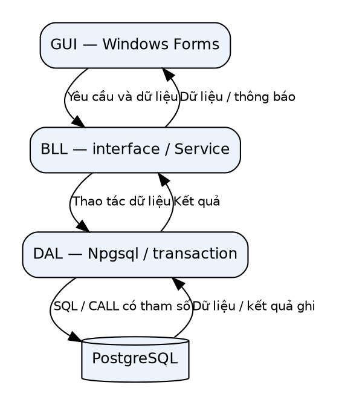
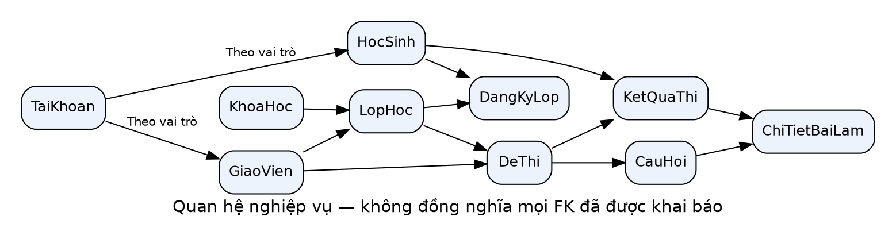
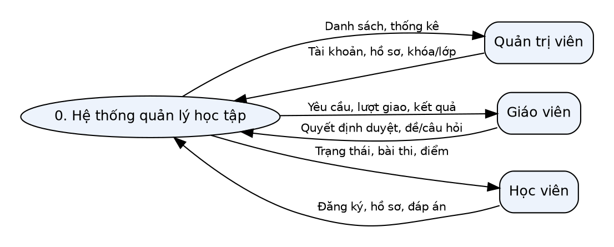
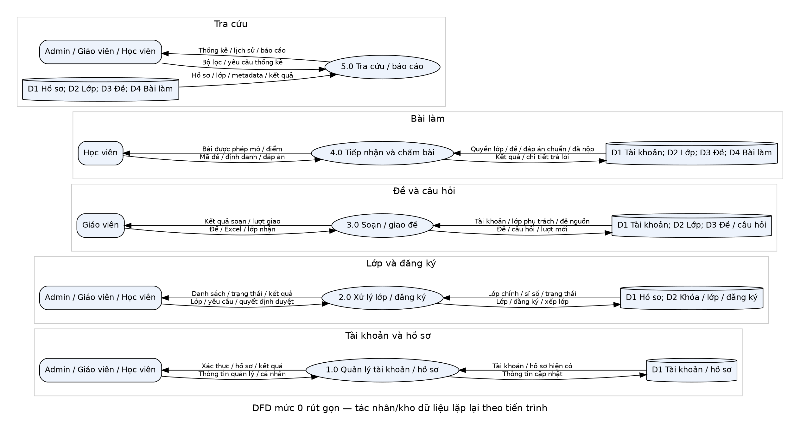

# Lời nói đầu

Quản lý học tập bao gồm các nghiệp vụ có liên hệ chặt chẽ như quản lý hồ sơ, tổ chức lớp, tiếp nhận đăng ký và đánh giá kết quả. Một hệ thống hỗ trợ cần xác định đúng người sử dụng, lớp được phép tham gia, đề được phép làm và kết quả của từng lượt thi. Đề tài được thực hiện nhằm vận dụng kiến thức lập trình trực quan và cơ sở dữ liệu vào bài toán đó.

Ứng dụng được xây dựng bằng C# WinForms trên .NET Framework 4.8, sử dụng PostgreSQL và Npgsql. Ba nhóm người dùng gồm quản trị viên, giáo viên và học viên có các màn hình và thao tác khác nhau. Báo cáo trình bày yêu cầu, thiết kế, triển khai, kiểm thử và các phần còn cần nghiệm thu.

Bản nháp này giữ cấu trúc cũ và đã đồng bộ nội dung 10 procedure theo nhánh `docs/bao-cao-hoan-chinh`, commit mã `b9c3b42c28d82be7c445a0062cd21793b587a3c3`. Bản Word/PDF chính theo mẫu người dùng cung cấp nằm tại `docs/bao_cao_hoan_chinh`. Thông tin nhóm, ảnh chạy thật và kết quả nghiệm thu Windows vẫn cần bổ sung trước khi nộp.

# Chương 1. Khảo sát bài toán và phân tích yêu cầu

## 1.1. Lý do và mục tiêu

Dữ liệu lớp học, hồ sơ và điểm cần được quản lý thống nhất để giảm thao tác đối chiếu thủ công. Khó khăn của bài toán nằm ở các điều kiện liên kết: học viên có thể tham gia nhiều lớp, lớp có sức chứa, đề có thời hạn và một bộ câu hỏi được giao nhiều lần. Ứng dụng cần quản lý chính xác các điều kiện này thay vì chỉ cung cấp màn hình nhập dữ liệu.

Mục tiêu của đề tài là hỗ trợ quản trị dữ liệu nền, đăng ký và duyệt lớp, chuẩn bị câu hỏi, tổ chức bài trắc nghiệm và tra cứu kết quả. Đây là phân tích bài toán từ chức năng và mã nguồn, chưa có khảo sát thực địa hoặc đo hiệu quả tại cơ sở đào tạo.

## 1.2. Phạm vi và tác nhân

Quản trị viên quản lý tài khoản, giáo viên, học viên, khóa học và lớp; có thể xếp lớp khi tạo học viên mới. Giáo viên quản lý lớp phụ trách, duyệt yêu cầu, soạn/giao đề và xem kết quả. Học viên đăng ký lớp, làm bài, xem lại kết quả và cập nhật hồ sơ.

Hệ thống không phải nền tảng web có REST API, EF Core, JWT hoặc video trực tuyến. Ứng dụng desktop kết nối PostgreSQL thông qua Npgsql. Các project .NET 8 chỉ phục vụ kiểm thử một số thành phần sản xuất; ứng dụng chính vẫn là net48.

## 1.3. Yêu cầu chức năng

| Nhóm | Nội dung |
|---|---|
| Tài khoản | Đăng nhập, liên kết hồ sơ, khóa/mở khóa, đổi và đặt lại mật khẩu |
| Hồ sơ | Thêm, sửa, xóa có kiểm tra và tìm kiếm giáo viên/học viên |
| Đào tạo | Quản lý khóa học, lớp, lịch và sức chứa |
| Đăng ký | Gửi/hủy yêu cầu, giáo viên duyệt/từ chối và đóng nhận đăng ký |
| Đề và câu hỏi | Soạn đề nháp, quản lý câu hỏi, nhập Excel, giao nhiều lượt |
| Kiểm tra | Kiểm tra quyền bắt đầu, chọn đáp án, đồng hồ, nộp và chấm bài |
| Kết quả | Lịch sử, xem lại, thống kê, Excel và luồng Crystal được chuẩn bị |

## 1.4. Yêu cầu phi chức năng

Các thao tác nhiều bước phải bảo toàn tính nhất quán. Không để kết quả tồn tại mà thiếu chi tiết trả lời, hoặc lượt giao tồn tại mà thiếu câu hỏi do lỗi giữa chừng. Quyền thao tác và sĩ số cần kiểm tra ở thời điểm ghi, không chỉ từ dữ liệu đã tải trên giao diện.

Giao diện cần giữ tiêu đề cột, hỗ trợ dữ liệu rỗng, ngày chưa chọn, tìm kiếm và phân trang. Báo cáo điểm cần giữ đúng giá trị số trên vi-VN/en-US. Chưa có phép đo tải nên không cam kết số người dùng đồng thời hoặc thời gian phản hồi cụ thể.

## 1.5. Công nghệ

| Thành phần | Công nghệ |
|---|---|
| Ngôn ngữ/runtime | C#, .NET Framework 4.8 |
| Giao diện | WinForms, ReaLTaiizor 3.8.2.1 |
| Truy cập DB | Npgsql 6.0.11, ADO.NET |
| CSDL | PostgreSQL; lần test dùng PostgreSQL 16 |
| Đọc Excel | ExcelDataReader 3.7.0 |
| Kiểm thử | xUnit 2.9.3, .NET 8, Python, Docker, Mono/Xvfb |
| Báo cáo | Excel XML/CSV; code và XSD tích hợp Crystal, còn mẫu/runtime Windows |

# Chương 2. Thiết kế và xây dựng hệ thống

## 2.1. Kiến trúc ba tầng

Giao diện Forms sử dụng các hợp đồng Service tại BLL. Service kiểm tra điều kiện phù hợp và gọi DAL; DAL thực hiện SQL, kiểm tra quyền liên quan dữ liệu và quản lý transaction. Các model truyền dữ liệu giữa các thành phần. Helpers chứa validation, phiên, phân trang và xử lý Excel.

Đã có 10 interface: ITaiKhoanService, IDeThiService, IHocSinhService, IGiaoVienService, ILopHocService, IKhoaHocService, IKetQuaService, IDashboardService, ICauHoiImportService và IBaoCaoService. Các lớp tương ứng triển khai hợp đồng. Form không gọi DAL hoặc DatabaseHelper trực tiếp. Việc phân chia này không đồng nghĩa đã xây dựng Domain đầy đủ; nhiều điều kiện gắn transaction vẫn được kiểm tra trong DAL.

## 2.2. Hướng đối tượng

Các Form kế thừa MaterialForm hoặc Form. Các Service triển khai interface và chứa đối tượng DAL, thể hiện hợp đồng, kế thừa và kết tập. GUI khai báo biến theo interface để tách khỏi kiểu DAL. Các constructor Service nhận DAL phục vụ việc lắp ghép; dự án chưa sử dụng DI container.

Các phương thức thao tác lớp/câu hỏi ở Service yêu cầu mã giáo viên để không làm mất ràng buộc quyền khi chuyển từ Form cũ sang ba tầng. Không tạo interface rỗng chỉ nhằm đạt số lượng.

## 2.3. Cơ sở dữ liệu

Mười bảng gồm TaiKhoan, GiaoVien, HocSinh, KhoaHoc, LopHoc, DangKyLop, DeThi, CauHoi, KetQuaThi và ChiTietBaiLam. HocSinh.LopHocID biểu thị lớp chính; DangKyLop lưu đăng ký và tư cách tham gia thêm lớp đã duyệt. DeThi dùng chung cấu trúc cho đề nháp và từng lượt giao độc lập.

Sơ đồ biểu diễn quan hệ logic, không chứng minh mọi đường nối đã có FOREIGN KEY vật lý. Schema khởi tạo còn thiếu FK/ràng buộc quan hệ; nhiều điều kiện đang được DAL bảo vệ. Các script SQL Server lịch sử trong Database/Scripts không được dùng trực tiếp cho PostgreSQL. Bộ script mới nằm ở Database/PostgreSQL.

## 2.4. Luồng dữ liệu

Người sử dụng trao đổi thông tin đăng nhập và dữ liệu nghiệp vụ với hệ thống. Quản trị viên nhận danh sách và thống kê; giáo viên nhận yêu cầu đăng ký và kết quả; học viên nhận trạng thái, nội dung bài được phép làm và điểm. PostgreSQL là kho nội bộ, không phải tác nhân ngoài của sơ đồ ngữ cảnh.

Các tiến trình mức 0 mô tả quản lý tài khoản/hồ sơ, xử lý lớp/đăng ký, soạn/giao đề, tiếp nhận bài làm và tra cứu. Đây là mô hình logic, không phải các dịch vụ mạng độc lập. Các kho dữ liệu được nhóm theo bảng để thuận tiện thuyết minh.

## 2.5. Đăng ký và quyền lớp

Học viên gửi yêu cầu Chờ duyệt. Giáo viên phụ trách duyệt/từ chối sau khi kiểm tra lớp và sức chứa. Nếu học viên đã có lớp chính, duyệt lớp mới không ghi đè lớp cũ. Sĩ số tính theo hợp lớp chính và đăng ký Đã duyệt, không đếm trùng người.

Mã lớp quyết định quyền; hai lớp trùng tên không được coi như một. Đóng nhận đăng ký không đóng đề đã giao hoặc thu hồi quyền làm bài của người đã thuộc lớp. Khi mở xác nhận, Form giữ ID và hoãn refresh để tránh mất lựa chọn do activation.

## 2.6. Đề, Excel và lượt giao

Câu hỏi có nội dung, bốn đáp án và đáp án đúng A–D. Bộ đọc Excel nhận .xlsx/.xls, giới hạn 20 MB và 5.000 câu; kiểm tra sáu cột, các dòng trống và lỗi nội dung. Khi một dòng sai, không nhập một phần. ImportService gọi DAL để kiểm tra quyền và ghi nguyên tử.

Mỗi lần giao tạo mã đề mới và bản sao câu hỏi. Một bộ đề có thể giao nhiều lớp hoặc nhiều lần; các lượt cũ giữ kết quả riêng. Form mặc định hạn nộp sau bảy ngày. Ẩn đề đặt trạng thái Đã xóa qua luồng có quyền, giữ metadata/câu hỏi/bài làm phục vụ lịch sử.

## 2.7. Nộp bài và tính điểm

Trước khi bắt đầu, hệ thống kiểm tra trạng thái, hạn, quyền lớp, câu hỏi và đã nộp. Phòng thi giữ đáp án trong bộ nhớ, đồng hồ dựa trên thời điểm kết thúc và hạn nộp. Đến giờ, việc sửa đáp án bị chặn và chương trình gọi nộp.

KetQuaService chuyển yêu cầu tới DAL. DAL khóa đề, kiểm tra tài khoản/quyền và đã nộp, đọc đáp án chuẩn từ DB, chấm theo số câu thực tế rồi lưu kết quả cùng chi tiết trong transaction. Điểm = Round(số câu đúng × 10 / số câu, 2). Không nhận điểm do Form tính sẵn làm căn cứ lưu.

Chưa có bản ghi lần bắt đầu và lưu nháp bền vững trong DB. Tắt đột ngột tiến trình có thể mất đáp án chưa nộp; đồng hồ chưa phải cơ chế chống gian lận phía server.

## 2.8. ADO.NET và stored procedure

Dự án sử dụng NpgsqlConnection, NpgsqlCommand, NpgsqlParameter và DataAdapter. CRUD hồ sơ có thêm/sửa/xóa/tìm kiếm. Truy vấn SQL nằm trong DAL thay vì Form.

Bản cập nhật có **10 procedure**: thêm/sửa/xóa khóa học, giáo viên, học viên và đóng đăng ký lớp. Xem [danh mục và hợp đồng](../Procedures_PostgreSQL.md). Luồng sửa khóa học gọi procedure study_sua_khoa_hoc bằng CALL có tham số. Procedure kiểm tra dữ liệu, cập nhật tên/mô tả và trả p_updated. Script 02_Procedures.sql có thể cài lặp lại; thiếu procedure được báo rõ, không fallback sang UPDATE để giả vờ đã dùng thủ tục. Script phải được cài lên DB triển khai trước khi dùng bản mới.

## 2.9. Báo cáo

Xuất Excel XML/CSV được giữ. Hộp thoại báo cáo bổ sung đường xem/in Crystal: load mẫu, SetDataSource bằng DataSet từ BaoCaoService và hiển thị viewer. XSD BangDiem xác định kiểu số/ngày và các cột cần cho mẫu; không lưu mật khẩu DB trong báo cáo.

Repository đã có Reports/BangDiem.rpt và BangDiem.cs; chưa nghiệm thu mẫu/viewer trên Windows có SAP runtime phù hợp. Vì vậy đây là phần tích hợp đã chuẩn bị, chưa phải chức năng Crystal đã nghiệm thu. Hướng dẫn hoàn tất ở Reports/README.md.

## 2.10. Cài đặt

Khôi phục NuGet của packages.config, chuẩn bị .NET Framework 4.8 targeting pack và build project bằng Visual Studio. Cấu hình ChuoiKetNoi đúng DB, chạy Database/PostgreSQL/01_Schema.sql rồi 02_Procedures.sql trên DB mới. Không bật seed mật khẩu mặc định trên môi trường làm việc.

Cài SAP SDK/runtime đúng Visual Studio và x86/x64 để tạo/chạy mẫu Crystal. Bộ cài cần lấy từ SAP. Ứng dụng vẫn có đường Excel khi chưa có Crystal. Chưa tự động áp dụng thay đổi lên DB thật hoặc máy Windows của nhóm.

# Chương 3. Kiểm thử, đánh giá và kết luận

## 3.1. Phương pháp

Kiểm thử kết hợp unit logic, tích hợp PostgreSQL và smoke WinForms. Runner tạo DB dùng một lần bằng Docker và xóa container/volume sau chạy. Các test không đọc App.config của ứng dụng. Một số file sản xuất được liên kết vào test host .NET 8; điều này không có nghĩa ứng dụng WinForms đã chuyển runtime sang .NET 8.

## 3.2. Kết quả

| Bộ kiểm tra | Kết quả |
|---|---|
| Build net48 bằng reference assemblies trên Linux | Thành công |
| Kiểm tra ranh giới GUI/BLL và đăng ký file | Đạt; 10 hợp đồng |
| Pagination.Tests | 19 đạt |
| StudentProfile.Tests | 29 đạt |
| ApplicationLogic.Tests | 172 đạt |
| Dashboard.Tests | 7 đạt |
| ExcelImport.Tests | 29 đạt |
| Tổng .NET 8 | 256 đạt; không bỏ qua/thất bại |
| Pagination.SmokeTests trên Mono/Xvfb | 89 assertion đạt |
| StudentRegistration.SmokeTests trên Mono/Xvfb | 16 assertion đạt |

SDK trong lần cập nhật 10 procedure là 8.0.428. Có 22 trường hợp mới; build net48 và smoke Mono trong bảng là bằng chứng lịch sử, chưa chạy lại trong phiên này. Các test mới kiểm tra gọi procedure qua Service, cài script lặp, dữ liệu chứa nháy/tiếng Việt, thiếu procedure, giữ quyền giáo viên, chống nộp lặp và dataset báo cáo trên hai văn hóa.

## 3.3. Kiểm tra Windows cần bổ sung

Cần chạy thực tế đăng nhập ba vai trò, CRUD, đăng ký/duyệt, giao đề nhiều lượt, làm bài/nộp/xem lại, nhập/xuất dữ liệu và resize/chuyển tab. Cần kiểm tra SAP, mẫu .rpt hiện có và xem/in báo cáo. Không lấy build Linux hoặc smoke Mono thay cho kiểm tra toàn bộ ReaLTaiizor trên Windows.

Chèn ảnh: đăng nhập; Admin; quản lý hồ sơ; lớp/duyệt; câu hỏi/import; giao đề; học viên; phòng thi; kết quả; Crystal. Ảnh phải lấy từ bản chạy thật với dữ liệu thử, không dùng mockup rồi ghi như bằng chứng.

## 3.4. Phối hợp nhóm

Năm mảng được giao cho TV1 tài khoản/kiến trúc, TV2 hồ sơ/CRUD, TV3 DB/lớp/procedure, TV4 đề/Excel/giao bài và TV5 phòng thi/kết quả/Crystal. Mỗi người viết tài liệu và demo phần mình. Review chéo theo vòng TV4→TV1, TV5→TV2, TV1→TV3, TV2→TV4, TV3→TV5.

Bảng tên, commit, nhận xét và điểm đánh giá chưa được điền vì phải phản ánh công việc thật. Tài liệu kế hoạch không tự chứng minh sự phối hợp đã thực hiện. Nhóm cần cập nhật docs/Phan_cong_va_danh_gia_cheo.md.

## 3.5. Đối chiếu và hạn chế

Sau bổ sung, có hơn năm interface và lớp triển khai, GUI qua BLL, procedure được ứng dụng gọi và kiểm thử. Các yêu cầu CRUD vẫn được duy trì. Mục Crystal chưa nghiệm thu mẫu/viewer trên Windows; mục phối hợp nhóm cần bằng chứng; bản Word/slide cần template và thông tin thực tế.

Hạn chế khác gồm schema chưa đủ FK, SHA-256 không salt, ghi nhớ Base64, phân trang trên dữ liệu đã tải, chưa lưu nháp và chưa có phép đo tải. Việc cải tiến tiếp theo cần migration có kiểm soát, thuật toán mật khẩu chuyên dụng, lưu trữ thông tin đăng nhập Windows an toàn và quản lý lần thi bền vững.

## 3.6. Kết luận

Đề tài hiện thực các nghiệp vụ quản lý học tập và kiểm tra trắc nghiệm trên desktop. Bản bổ sung củng cố hợp đồng hướng đối tượng, ranh giới ba tầng và ví dụ thủ tục PostgreSQL có thể chạy thật. Kết quả kiểm thử cung cấp bằng chứng cho các phạm vi đã chạy, đồng thời chỉ rõ phần chưa nghiệm thu.

Hệ thống chưa được coi là đáp ứng toàn bộ thang điểm khi Crystal và minh chứng nhóm còn thiếu. Sau khi hoàn tất các bước Windows, nhóm cần cập nhật ảnh, kết quả và phiên bản mã nguồn để bản nộp phản ánh đúng sản phẩm cuối cùng.

# Tài liệu tham khảo

1. Repository Kast261/Study-management_WinformC- và nhánh bổ sung của đề tài.
2. Microsoft Learn: Windows Forms và .NET Framework 4.8 — https://learn.microsoft.com/dotnet/desktop/winforms/
3. Npgsql documentation — https://www.npgsql.org/doc/basic-usage.html
4. PostgreSQL documentation — https://www.postgresql.org/docs/16/
5. SAP Crystal Reports for Visual Studio — https://www.sap.com/products/technology-platform/crystal-reports/visual-studio.html
6. README các dự án tests và docs/Ket_qua_kiem_thu.md trong repository.

# Phụ lục: bàn giao

- Script PostgreSQL: Database/PostgreSQL/01_Schema.sql và 02_Procedures.sql.
- Kiểm tra kiến trúc: python3 tests/check_architecture.py.
- Test DB: python3 tests/StudentProfile.Tests/run.py --project tests/ApplicationLogic.Tests/ApplicationLogic.Tests.csproj.
- Crystal: Reports/README.md và Reports/BangDiem.xsd.
- Phân công/review: docs/Phan_cong_va_danh_gia_cheo.md.

Các thông tin cần nhóm điền trước nộp: trường/khoa/môn; giảng viên; tên/MSSV; template; ảnh Windows; mẫu .rpt; biên bản review và kết quả demo. Không tự đặt điểm cá nhân hoặc cam kết điểm số.
